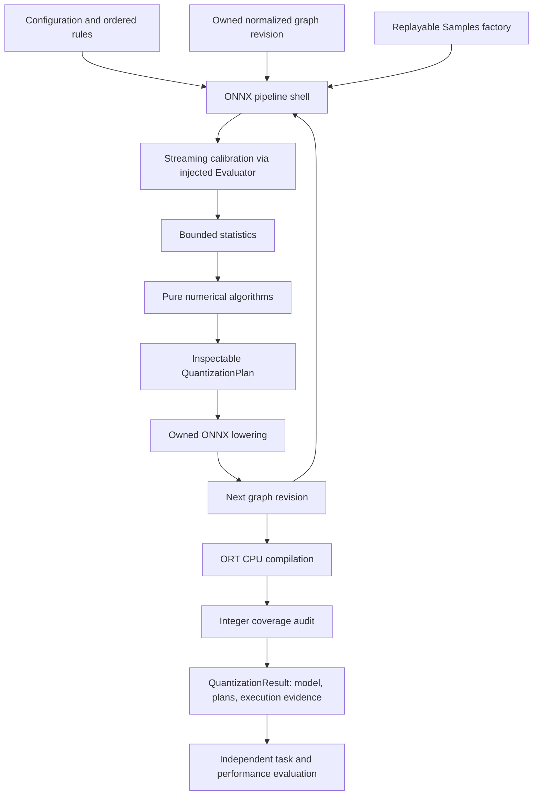
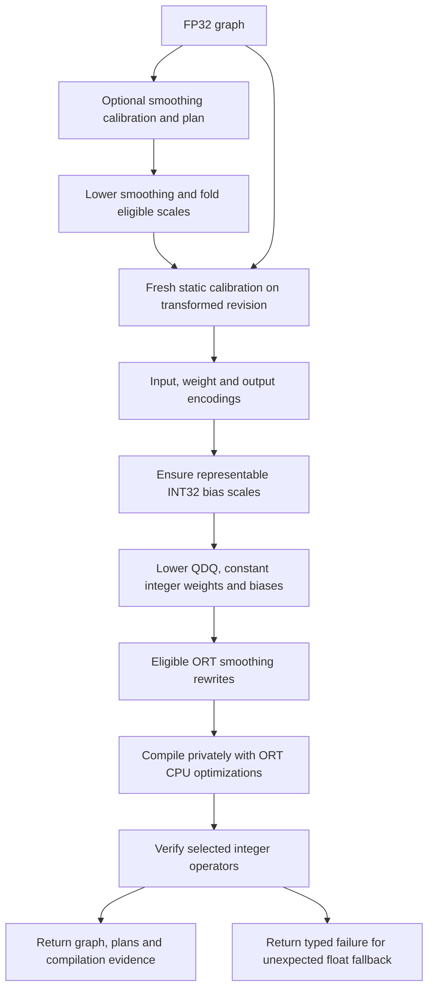

# QuantSmith architecture

Created: 2026-10-17 · Status: implemented, with restrictions below

Author: Vadym Stupakov <vadim.stupakov@gmail.com>

## Objective and background

Turn an FP32 graph and replayable representative inputs into inspectable
quantization decisions and an ORT executable with verified integer coverage.
Smaller serialized weights alone do not establish integer execution, lower RAM,
or lower latency. Before the execution adapter, ResNet18 MinMax compiled only
8 of 20 convolutions to integer kernels despite integer weight storage.

## Component boundaries

- `domain/` owns graph snapshots, encodings and native arrays. Constructors copy
  caller-owned constants and freeze returned storage.
- `rules/` selects algorithms in declaration order; the last matching rule wins.
  Explicit exclusions remain authoritative.
- `algorithms/` declares requirements and computes plans from supplied statistics.
  Algorithms have no ONNX, ORT, filesystem or dataset dependencies.
- `optimization/smoothing/` defines pure output-error selection and immutable
  reports. The optional ORT selection stage constructs and audits whole-graph
  candidates, then streams paired output replay. See
  [output-based smoothing](output-based-smoothing.md) for coordinate protection,
  the numerical objective and experimental restrictions.
- `calibration/` streams samples and maintains aggregate ranges/histograms.
  Histogram replay must reproduce the same inputs. No activation dataset is kept.
- `plan/` describes consumer input quantization, producer output quantization,
  reconstructed constants and paired channel rescaling. Conflicting writes fail
  before lowering; transforms and quantization cannot share a calibration revision.
- `backends/onnx/` admits graphs, lowers plans on owned copies and runs the staged
  shell. `integer_execution/` adapts built-in static methods to the CPU execution
  contract. `ort_scaling/` plans specialized smoothing rewrites.
- `runtime/` instruments graph values with optimizations disabled for calibration
  by default. Output-based selection explicitly uses optimized sessions;
  deployment measurements remain independent of diagnostic instrumentation.
- `examples/` owns pretrained model loading, preprocessing, data selection, task
  metrics and artifact presentation. Generated data and graphs stay in `work_dir/`.

There is no new optimizer trait or Optuna dependency. Numerical algorithms and
execution policy have different reasons to change; the execution adapter does not
replace the existing algorithm protocols.

## Revision and execution ordering

Calibration always observes the revision being planned. Smoothing statistics
cannot be reused for subsequent quantization. The returned model is the lowered
ONNX graph; hardware-dependent optimized snapshots are temporary audit artifacts,
not portable deployment exports.

## Contracts and design choices

Expected data, unsupported execution and I/O failures use `Ok`/`Err` with a typed
diagnostic. Programming errors and unexpected plugin failures remain exceptions.
Custom algorithms retain their established contracts; only built-in `StaticW8A8`
is automatically completed by the execution adapter.

The default static pipeline verifies compiled integer Conv, Gemm and constant-weight
MatMul operations and eligible UINT8 residual Add operations. Unsupported layouts
are excluded before quantization and retain FP32 computation. The execution
report gives verified operators and source nodes outside that guarantee. A node
outside the guarantee may be fused away by ORT; it is not necessarily a separately
executed floating kernel.

The low-level `build_plan` + `lower` API remains useful for numerical experiments
and does not itself promise integer execution. Reconstruction results have an
explicit `Absent` execution report until they acquire equivalent completion and
audit support. See [integer execution](integer-execution.md) for restrictions.

## Alternatives and restrictions

We use fusion-compatible QDQ and audit its compiled result. Direct QOperator
emission remains an alternative, not a presumed improvement: the local ResNet18
reference experiment gave about 8.84 ms for QDQ versus 9.51 ms for QOperator.

The audit target is CPUExecutionProvider, one compilation thread and ORT_ENABLE_ALL.
It is compilation evidence, not a latency benchmark or a guarantee for another
provider, runtime build, session setting or device. Accuracy, ROM and RAM remain
independent measured outcomes. There are no universal performance acceptance gates.

## Activation-function-aware calibration

The ORT pipeline exposes opt-in `outputs=FunctionOutputs()`. Pure eligibility
and the `ActivationFunctionRanges` decorator are isolated in
`integer_execution/activation_function_ranges.py`; standalone numerical algorithms
retain their contracts. The decorator observes private Relu/Clip outputs for
built-in static Conv output encodings. It preserves revision-separated calibration
and the compiled integer audit. See the
[design, Mermaid flow and limitations](integer-execution.md#activation-function-aware-calibration).

## TBD

- Complete and audit reconstruction pipelines without changing learned codes.
- Expand capability tests for other providers and model/operator families.
- Preserve provenance if future ORT versions change source-node naming during
  fusion; currently unrecognized provenance fails closed.
- Extend activation-function-aware calibration beyond private Relu/Clip edges,
  investigate shared encodings and remove further redundant conversions;
  output quantization can reduce accuracy and add overhead.
- Separate steady-state runtime memory from startup peak and process overhead.
- Add graph search only after legal rewrite choices and measurements are reliable.

## Related documentation

[Integer execution design](integer-execution.md) ·
[ONNX backend](../src/quantsmith/backends/onnx/README.md) ·
[Plans](../src/quantsmith/plan/README.md) ·
[Algorithm contracts](../src/quantsmith/algorithms/README.md)

## Declarative pipeline and facade

The [typed pipeline design](declarative-pipeline.md) describes the implemented
`Quantizer.from_config(config).quantize(model).calibrate(iterable)` lifecycle,
open `Step` protocol, graph phases, ADT policies, and fold-only smoothing.
Concrete ORT steps declare their transitions; the shell no longer infers stage
kinds from algorithm output. There is no backend selection abstraction.

## Coordinated smoothing and shared quantizers

The [joint smoothing experiment](joint-smoothing.md) adds a pure planning algorithm,
transactional complete-group affine folding, and an exact quantizer-reuse step using
the existing typed pipeline contracts. The last step precedes compilation and audit.
It reuses identical private computations and preserves grids; joint smoothing changes
the grids after fresh calibration. Their quality and latency evidence are separate.

## Per-channel distribution statistics

`Needs.channel_histograms` declares typed single-axis requests. The calibration
shell establishes extrema, checks the configured memory cap, and streams replay
into dedicated immutable channel distributions. Pure numerical policies choose
balancing ranges; lowering and fresh subsequent calibration retain their revision
boundaries. The existing per-tensor calibration protocol is unchanged. See
[contracts, memory bounds and measurements](channel-histograms.md).
