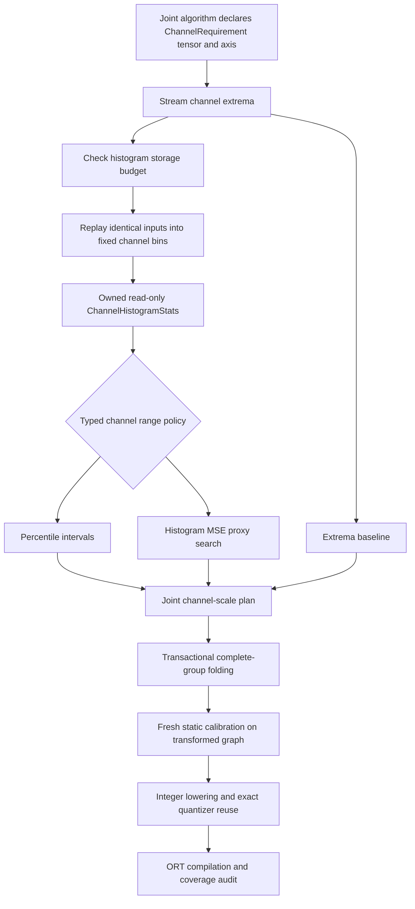

# Per-channel histograms for joint smoothing

Created: 2026-10-17 · Status: implemented and measured; accepted recipes retain
their previous declarations pending review of the tables below.

Author: Vadym Stupakov <vadim.stupakov@gmail.com>

Authoritative source: this repository's `docs/channel-histograms.md`.

## Contents

- [Objective and motivation](#objective-and-motivation)
- [Architecture and contracts](#architecture-and-contracts)
- [Typed policy and budget configuration](#typed-policy-and-budget-configuration)
- [Experiment and verification](#experiment-and-verification)
- [Measurements](#measurements)
- [Interpretation and decisions](#interpretation-and-decisions)
- [Verification and remaining work](#verification-and-remaining-work)
- [Evidence and local reproduction](#evidence-and-local-reproduction)

## Objective and motivation

Use channel distributions to choose offline smoothing scales and measure whether
this improves task quality at the same integer execution cost. Previously,
SmoothQuant used channel extrema; the histogram collector supported only tensor
ranges. That was an implementation restriction, not evidence against channel
histograms.

Two channels can have the same maximum of 100, but one reaches it once while the
other reaches it frequently. Extrema cannot distinguish them; channel histograms
can. Percentile selection uses central probability mass. The MSE policy searches
candidate intervals using estimated eight-bit clipping and rounding error.

This change adds per-channel statistics. Weights already use per-channel encodings;
the final activation encoding remains per-tensor in this execution path. Histogram
ranges guide the scale vector folded into affine parameters. They do not add
activation clipping nodes or per-channel activation kernels.

## Architecture and contracts



`ChannelRequirement(tensor, axis)` requires one explicit retained axis. Its `range`
property identifies the extrema needed for histogram boundaries. `Needs` adds a
separate `channel_histograms` tuple; the core deduplicates requests and includes
their prerequisite ranges. `Statistics.channel_histograms` is a typed read-only
mapping from those requests to channel distributions.

`ChannelHistogramStats` owns float64 edges shaped `[channels, bins + 1]` and int64
counts shaped `[channels, bins]`. Every channel must have finite increasing edges,
nonnegative populated counts, and matching dimensions. Constructors reject wrong
native dtypes rather than coercing them. Returned arrays and mappings own frozen
storage; caller arrays remain independent.

The existing `HistogramStats` and `Calibration.interval` contracts remain
per-tensor. They are not weakened to accept a union of unrelated shapes. Existing
algorithms request no channel histograms unless configured to do so.

Collection keeps the current batch, fixed statistics and one channel's counting
temporary. It does not cache samples or activations between batches. Channel views
avoid copying the entire activation tensor to rearrange axes. Invalid axes, changed
channel counts, missing observations, nonfinite arrays and out-of-range replay
return typed errors. A source must still replay the same inputs: range checks do
not prove identical replay when changed values remain inside the original bounds.
A failed collection discards its private counters.

## Typed policy and budget configuration

```python
from quantsmith import Quantizer
from quantsmith.algorithms.smoothquant.joint.ranges import ChannelMSE
from quantsmith.config import JointSmoothQuantConfig, QuantizationConfig

config = QuantizationConfig(
    smoothing=JointSmoothQuantConfig(
        alpha=0.5,
        channels=ChannelMSE(min_percentile=99.0, candidates=16),
    ),
    histogram_bins=2048,
    max_channel_histogram_bytes=2 * 1024**3,
)
outcome = Quantizer.from_config(config).quantize(model_proto).calibrate(dataset)
```

The closed built-in choices are `ChannelExtrema()`,
`ChannelPercentile(percentile=...)`, and `ChannelMSE(min_percentile=..., candidates=...)`.
They are validated ADTs with typed matching. The Python algorithm protocol remains
open to custom methods. JSON discriminators belong to configuration admission;
there is no string-keyed execution registry.

Channel percentile uses the same equal-tail, enclosing-bin rule as existing
Percentile calibration, independently for each coordinate. A percentile of 100
preserves the observed range exactly.

Channel MSE evaluates uniformly spaced candidate percentiles from `min_percentile`
to 100, including the full observed range. For each channel it weights squared
clipping and rounding error at bin midpoints by the original counts. It uses an
asymmetric eight-bit affine grid including real zero. Ties prefer the full range.
Temporary search arrays cover one channel at a time.

This is a **range-selection proxy**: it is not final network loss, combined
activation/weight error, or the exact final per-tensor activation grid. Histogram
binning is also an approximation. A smaller proxy error does not guarantee better
final quantized accuracy. The experimental policies use the selected ranges for
balancing; the following static stage still recalibrates actual transformed data.

Storage is proportional to requested channels and bins, independent of dataset
length. Counts alone for 1,024 channels and 2,048 bins require 16 MiB; independent
edges require about another 16 MiB. The budget check includes both accumulator
storage and immutable result copies, before allocating the histograms or replaying
samples. Model storage, current evaluator activations and small validation/counting
temporaries are outside that histogram budget. The first extrema pass is needed
to establish dimensions and therefore precedes the check.

The default histogram budget is 512 MiB. This experiment explicitly uses a 2 GiB
cap. A caller can change that cap or the bin count; an insufficient budget produces
an explicit error and never silently changes the calibration policy.

## Experiment and verification

Compare extrema, channel Percentile 99.9, and channel MSE with a 99.0 percentile
floor and 16 candidates. All use alpha 0.5 and 2,048 bins, followed independently
by static MinMax and static Percentile 99.99. Other graph, reconstruction and
activation-function policies remain fixed. No held-out scores select parameters.

Reuse a single immutable set of channel observations for alternative plans of the
same original FP32 graph. Every accepted transformed graph then receives fresh
static calibration. This avoids repeated histogram collection without reusing
statistics across graph revisions. Public facade builds are checked independently
against these experiment builds.

Use the same five saved checkpoints and data as the
[joint smoothing study](joint-smoothing.md): TorchVision ResNet18, MobileNetV2 and
EfficientNet-B0 with 128 seeded Imagenette training calibration images and 256
held-out images; global/windowed Stackformers checkpoints with 64 calibration
contexts and 128 held-out contexts / 4,096 next-token targets. These transformers
have two layers, width 64, four heads, sequence length 32 and 600 training steps.
Windowed attention exports dense masked attention; these are small trained models.

ORT 1.30.0, CPUExecutionProvider, ORT_ENABLE_ALL, one intra/inter-op thread, batch one.
Timing uses fresh workers with 50 warmups, then 300 image or 1,000 token runs.
A separate session retains 100 profiling runs as raw ORT JSON. Profiling durations
are diagnostic and include instrumentation overhead. ROM means ONNX file bytes;
RAM below is the fresh runtime process peak RSS including initialization, not
steady-state tensor RAM or calibration workspace.

The tests cover channel axes, constant channels, exact counts, malformed records,
ownership, streaming retention, budget propagation/rejection, distribution-aware
ranges, proxy minimization and unchanged extrema endpoints. Real Torch exports
cover all three channel policies on both Stackformers models and all three CNNs,
with float parity and compiled integer coverage. Static rejection cases protect
required axes and immutable channel-statistics mappings.

## Measurements

### Histogram storage and float parity

The experiment collects each graph's histograms once for alternative plans of that
same revision. Production `ChannelExtrema` itself does not request this storage or
replay. The byte counts below are retained edges/counts; the budget reserves twice
that amount for collection plus immutable result copies.

| Model | Requested channels | Retained histograms MiB | Reserved storage MiB | Max float error across policies, one calibration batch |
| --- | ---: | ---: | ---: | ---: |
| transformer | 618 | 19.32 | 38.63 | 0.00000408 |
| windowed_transformer | 618 | 19.32 | 38.63 | 0.00000286 |
| resnet18 | 3907 | 122.12 | 244.25 | 0.00000650 |
| mobilenet_v2 | 9923 | 310.17 | 620.34 | 0.00000572 |
| efficientnet_b0 | 21391 | 668.63 | 1337.26 | 0.00000477 |

### Complete model × policy × method results

`channels_extrema_*` is the joint-smoothing baseline with exact reuse.
`channels_percentile_*` uses channel Percentile 99.9; `channels_mse_*` uses channel
histogram MSE. The final suffix is the independently calibrated static method.
`int8_*` are accepted saved controls, including the older runtime SmoothQuant.
Timing reuses the same saved fixed input for every variant of a model; accuracy
uses the real held-out data described above.

| Model | Variant | Median ms | ROM KiB | Peak RSS MiB | Top-1 % | Perplexity |
| --- | --- | ---: | ---: | ---: | ---: | ---: |
| transformer | onnx_fp32 | 0.0865 | 527.4 | 73.6 | 41.06 | 7.9636 |
| transformer | int8_smoothquant | 0.1048 | 355.6 | 74.4 | 40.99 | 7.9850 |
| transformer | int8_percentile | 0.0951 | 345.5 | 74.0 | 40.60 | 7.9658 |
| transformer | int8_minmax | 0.0959 | 345.5 | 74.0 | 40.94 | 7.9762 |
| transformer | channels_extrema_minmax | 0.0925 | 343.3 | 74.1 | 40.94 | 7.9739 |
| transformer | channels_extrema_percentile | 0.0914 | 343.3 | 74.0 | 40.72 | 7.9698 |
| transformer | channels_percentile_minmax | 0.0921 | 343.3 | 74.1 | 40.94 | 7.9794 |
| transformer | channels_percentile_percentile | 0.0920 | 343.3 | 74.2 | 40.70 | 7.9620 |
| transformer | channels_mse_minmax | 0.0915 | 343.3 | 74.1 | 41.14 | 7.9854 |
| transformer | channels_mse_percentile | 0.0920 | 343.3 | 73.8 | 40.62 | 7.9784 |
| windowed_transformer | onnx_fp32 | 0.0832 | 532.7 | 73.7 | 40.92 | 7.9329 |
| windowed_transformer | int8_smoothquant | 0.1025 | 360.9 | 74.5 | 40.94 | 7.9541 |
| windowed_transformer | int8_percentile | 0.0945 | 350.7 | 74.1 | 41.02 | 7.9478 |
| windowed_transformer | int8_minmax | 0.0941 | 350.7 | 74.1 | 41.02 | 7.9579 |
| windowed_transformer | channels_extrema_minmax | 0.0937 | 348.5 | 74.0 | 40.77 | 7.9406 |
| windowed_transformer | channels_extrema_percentile | 0.0932 | 348.5 | 74.0 | 40.80 | 7.9400 |
| windowed_transformer | channels_percentile_minmax | 0.0933 | 348.5 | 74.0 | 40.84 | 7.9555 |
| windowed_transformer | channels_percentile_percentile | 0.0944 | 348.5 | 74.1 | 40.80 | 7.9376 |
| windowed_transformer | channels_mse_minmax | 0.0934 | 348.5 | 74.2 | 40.67 | 7.9445 |
| windowed_transformer | channels_mse_percentile | 0.0934 | 348.5 | 73.9 | 40.72 | 7.9423 |
| resnet18 | onnx_fp32 | 4.4222 | 45733.3 | 213.1 | 66.02 | — |
| resnet18 | int8_smoothquant | 9.7906 | 11647.0 | 123.7 | 67.19 | — |
| resnet18 | int8_percentile | 9.5077 | 11629.8 | 123.2 | 67.19 | — |
| resnet18 | int8_minmax | 9.5446 | 11629.8 | 123.2 | 66.41 | — |
| resnet18 | channels_extrema_minmax | 9.0444 | 11629.1 | 120.1 | 66.80 | — |
| resnet18 | channels_extrema_percentile | 9.5576 | 11629.9 | 123.2 | 66.80 | — |
| resnet18 | channels_percentile_minmax | 9.1250 | 11629.1 | 119.9 | 67.19 | — |
| resnet18 | channels_percentile_percentile | 9.6727 | 11629.9 | 123.1 | 69.53 | — |
| resnet18 | channels_mse_minmax | 9.1205 | 11629.1 | 119.9 | 67.19 | — |
| resnet18 | channels_mse_percentile | 9.5179 | 11629.9 | 123.2 | 67.19 | — |
| mobilenet_v2 | onnx_fp32 | 4.3879 | 13882.5 | 116.5 | 64.06 | — |
| mobilenet_v2 | int8_smoothquant | 4.2441 | 4065.5 | 108.9 | 61.33 | — |
| mobilenet_v2 | int8_percentile | 3.8005 | 4031.6 | 107.9 | 63.67 | — |
| mobilenet_v2 | int8_minmax | 3.7515 | 4031.6 | 108.1 | 58.59 | — |
| mobilenet_v2 | channels_extrema_minmax | 3.7591 | 4030.6 | 107.8 | 58.20 | — |
| mobilenet_v2 | channels_extrema_percentile | 3.7974 | 4032.2 | 107.9 | 63.28 | — |
| mobilenet_v2 | channels_percentile_minmax | 3.8065 | 4030.6 | 107.6 | 57.81 | — |
| mobilenet_v2 | channels_percentile_percentile | 3.8019 | 4032.2 | 107.9 | 65.23 | — |
| mobilenet_v2 | channels_mse_minmax | 3.7603 | 4030.6 | 107.7 | 60.16 | — |
| mobilenet_v2 | channels_mse_percentile | 3.8194 | 4032.2 | 107.9 | 63.28 | — |
| efficientnet_b0 | onnx_fp32 | 11.6782 | 21214.9 | 142.2 | 75.00 | — |
| efficientnet_b0 | int8_smoothquant | 9.0241 | 6445.0 | 134.7 | 30.08 | — |
| efficientnet_b0 | int8_percentile | 8.5615 | 6384.0 | 133.1 | 64.84 | — |
| efficientnet_b0 | int8_minmax | 8.5331 | 6384.0 | 133.0 | 28.52 | — |
| efficientnet_b0 | channels_extrema_minmax | 8.5186 | 6383.2 | 132.8 | 26.17 | — |
| efficientnet_b0 | channels_extrema_percentile | 8.5618 | 6384.6 | 133.8 | 63.28 | — |
| efficientnet_b0 | channels_percentile_minmax | 8.5113 | 6383.2 | 133.1 | 28.52 | — |
| efficientnet_b0 | channels_percentile_percentile | 8.5865 | 6384.6 | 133.2 | 62.50 | — |
| efficientnet_b0 | channels_mse_minmax | 8.5222 | 6383.2 | 133.5 | 25.78 | — |
| efficientnet_b0 | channels_mse_percentile | 8.6079 | 6384.6 | 133.2 | 63.28 | — |

### Repeated timing

Fresh workers run serially; repeat 2 reverses candidate order. These repetitions
are not confidence intervals. Accuracy is deterministic for each fixed optimized
graph and split; the table above retains all variants, not just faster runs.

| Model | Variant | Repeat 1 ms | Repeat 2 ms |
| --- | --- | ---: | ---: |
| transformer | onnx_fp32 | 0.0838 | 0.0824 |
| transformer | int8_percentile | 0.0944 | 0.0949 |
| transformer | channels_extrema_percentile | 0.0935 | 0.0932 |
| transformer | channels_percentile_percentile | 0.0936 | 0.0937 |
| transformer | channels_mse_percentile | 0.0934 | 0.0939 |
| windowed_transformer | onnx_fp32 | 0.0833 | 0.0835 |
| windowed_transformer | int8_percentile | 0.0957 | 0.0952 |
| windowed_transformer | channels_extrema_percentile | 0.0909 | 0.0922 |
| windowed_transformer | channels_percentile_percentile | 0.0927 | 0.0915 |
| windowed_transformer | channels_mse_percentile | 0.0936 | 0.0938 |
| resnet18 | onnx_fp32 | 4.5008 | 4.4781 |
| resnet18 | int8_percentile | 9.4998 | 9.9754 |
| resnet18 | channels_extrema_percentile | 9.4283 | 9.9234 |
| resnet18 | channels_percentile_percentile | 9.4296 | 9.8610 |
| resnet18 | channels_mse_minmax | 8.9704 | 9.2211 |
| resnet18 | channels_mse_percentile | 9.4625 | 9.6074 |
| mobilenet_v2 | onnx_fp32 | 4.4455 | 4.4510 |
| mobilenet_v2 | int8_percentile | 3.7956 | 3.8130 |
| mobilenet_v2 | channels_extrema_percentile | 3.8009 | 3.8157 |
| mobilenet_v2 | channels_percentile_percentile | 3.8130 | 3.7849 |
| mobilenet_v2 | channels_mse_percentile | 3.7906 | 3.8223 |
| efficientnet_b0 | onnx_fp32 | 11.6518 | 11.7014 |
| efficientnet_b0 | int8_percentile | 8.5587 | 8.5557 |
| efficientnet_b0 | channels_extrema_percentile | 8.5478 | 8.5549 |
| efficientnet_b0 | channels_percentile_percentile | 8.5522 | 8.6201 |
| efficientnet_b0 | channels_mse_percentile | 8.5613 | 8.5410 |

## Interpretation and decisions

- ResNet18 channel Percentile + static Percentile reaches **69.53%** top-1 versus
  **66.80%** for joint extrema + static Percentile and **67.19%** for accepted
  Percentile. Integer inference still takes about twice FP32 latency here.
- MobileNetV2 channel MSE + static MinMax reaches **60.16%** versus **58.20%** for
  joint extrema + MinMax and **58.59%** for accepted MinMax. Its channel MSE +
  static Percentile stays at **63.28%**, below accepted Percentile's **63.67%**.
- EfficientNet-B0 channel Percentile + static Percentile declines to **62.50%**
  versus **63.28%** for joint extrema and **64.84%** for accepted Percentile.
  Channel MSE + static Percentile stays at **63.28%**. Its MinMax quality remains
  poor; per-channel statistics do not by themselves repair that execution recipe.
- Global transformer channel Percentile + static Percentile improves perplexity
  from **7.9698** for joint extrema to **7.9620**, while top-1 drops by one of
  4,096 targets. Channel MSE + MinMax improves top-1 but worsens perplexity.
- Windowed transformer channel Percentile + static Percentile improves perplexity
  from **7.9400** to **7.9376**, with unchanged **40.80%** top-1 relative to joint
  extrema. Accepted static Percentile has **41.02%** top-1 and **7.9478** perplexity,
  so comparison against that control remains a tradeoff.

Per-channel distributions demonstrably change scale decisions and can improve
quality, but neither policy improves every task metric/model. MSE minimizes its
specified histogram proxy, not the actual final per-tensor quantization loss.
Existing recipes and defaults therefore remain unchanged for review. No universal
accuracy tolerance or automatic winner selection is added. These small evaluation
splits support observations, not population-level accuracy claims.

The folded structures and verified integer coverage stay unchanged across channel
policies. Histogram calibration introduces no runtime nodes; it does not create
a separate systematic inference speedup. Measured timing differences can still
reflect encoding-dependent kernel paths and run variation. ROM and fresh runtime
RSS remain separate measurements from the additional calibration workspace.

## Verification and remaining work

All **756 tests** pass, along with Ruff checks/formatting and strict Pyrefly.
All **12** transformer configurations rebuilt through the full fluent facade are
byte-identical to the independently assembled experiment graphs: three channel
policies × two static methods × two models.

TBD: larger held-out evaluation; tune on a separate split before final evaluation;
compare objectives that account jointly for the actual per-tensor activation grid
and weight quantization. Histogram-estimated channel error is a deliberate first
proxy. Shared axes with equivalent positive/negative spellings and improved
calibration workspace scheduling remain separate extensions. No new nonlinear
integer kernels or per-channel activation execution are claimed.

## Evidence and local reproduction

`work_dir/artifacts/channel_histograms/` retains:

- `cases.json`, `scores.json`: all 50 model/control/policy/method cases.
- `evidence.json`: policy parameters, bin count, budget, actual histogram storage,
  channel-distribution checksums, folding counts and sampled float-parity errors.
- `facade_identity.json`: byte identity and graph hashes for all 12 public builds.
- `repeats.json`: forward/reverse timing results with exact trace directories.
- `fingerprints.json`: SHA-256 identities of all graph and fixed input files.
- `*.execution.json`: post-rewrite integer coverage for every constructed variant.
- Each `profile_*` and `repeat_*` directory: optimized graph, measured report,
  worker log and raw `ort_*.json` traces. Folded float graphs are also retained.

Local scripts are `work_dir/benchmark_channel_histograms.py`,
`work_dir/verify_channel_facade.py`, `work_dir/repeat_channel_histograms.py`, and
`work_dir/report_channel_histograms.py`. They consume the saved checkpoints and
cached data described above. Generated artifacts and these local research scripts
are not installed package entry points or committed datasets. The reusable
implementation and offline real-model export tests live in the tracked source/tests.
