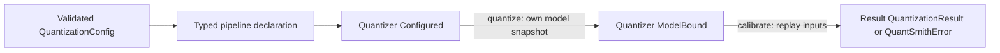
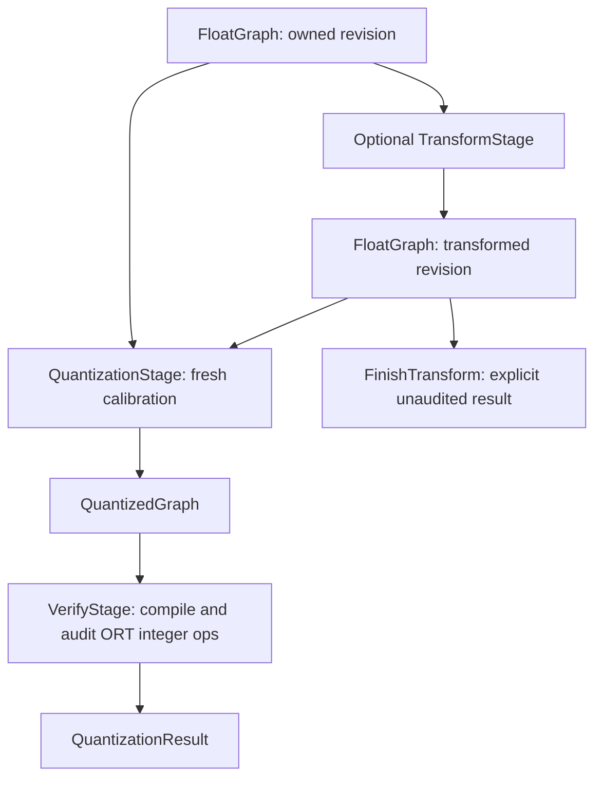

# Typed ORT quantization pipeline

Created: 2026-10-17 · Status: implemented on the refactor branch

Author: Vadym Stupakov <vadim.stupakov@gmail.com>

Authoritative source: this repository's `docs/declarative-pipeline.md`.

## Objective and background

Make quantization stages explicit and composable while retaining the pure numerical
core. The previous shell inferred a stage's purpose from the operations generated
by its algorithms. That coupled execution order to runtime inspection and made
extensions difficult to reason about. The broader activation-function experiment
also changed accuracy; it remains archived on
`experiment/broad-activation-regressions`, outside this refactor.

The project targets ONNX Runtime. ONNX is its serialized graph format. No backend
selection protocol or backend type parameter is needed.

## Lifecycle and interfaces



```python
from quantsmith import Quantizer, Replay
from quantsmith.config import QuantizationConfig, SmoothQuantConfig

config = QuantizationConfig(smoothing=SmoothQuantConfig())
outcome = Quantizer.from_config(config).quantize(model_proto).calibrate(dataset)
# For a generator, pass Replay(lambda: fresh_generator()) instead of the iterator.
```

`quantize` binds an owned protobuf snapshot. `calibrate` validates and executes it,
returning the local `Ok | Err` union. A configured quantizer can bind multiple
models; a bound job can run again with another representative source. Expected
model/data failures occur at calibration, before consuming inputs for invalid
graphs. Programming errors and unexpected plugin failures remain exceptions.

A regular iterable must replay the same samples. One-shot iterators are rejected;
`Replay(factory)` makes their recreation explicit. The shell streams batches and
bounded aggregate statistics; it never caches the calibration dataset. The caller
is responsible for deterministic replay and representative inputs.

## Declarative stages and extensions



```python
from quantsmith.algorithms.smoothquant import SmoothQuant
from quantsmith.algorithms.static import StaticW8A8
from quantsmith.backends.onnx.stages import (
    QuantizationStage,
    TransformStage,
    VerifyStage,
)
from quantsmith.config import supported
from quantsmith.pipeline import FoldOnly, Pipeline

program = (
    Pipeline(TransformStage(supported(SmoothQuant()), FoldOnly()))
    .then(QuantizationStage(supported(StaticW8A8())))
    .then(VerifyStage())
)
outcome = Quantizer.from_pipeline(program).quantize(model_proto).calibrate(dataset)
```

`Step[Before, After]` is an open structural protocol with one `run(value, context)`
method. Custom steps compose directly with `Pipeline.then`; no registry, runtime
keys, reflection, or central plugin dispatch is involved. Existing `Algorithm`,
`Rules[Algorithm]`, `Evaluator`, and `Samples` extension contracts remain intact.
The context injects replay and histogram bounds into execution steps. Side effects
remain in concrete ORT stages; numerical planning remains independent of ONNX.

Pyrefly rejects calibration before model binding and composing a float transform
after quantization. Runtime guards reject a transform returning quantization
operations or a quantization stage returning rescaling operations: the open
`Algorithm` protocol does not statically encode its plan effect. Frozen records
prevent rebinding fields; ownership copies, rather than frozen protobufs, protect
caller graphs. Static types do not prove tensor shapes, deterministic replay,
accuracy, or speed.

## Typed policies and migration

| Earlier interface | Replacement |
| --- | --- |
| `config.stages()` and implicit rules tuples | `config.pipeline()` or explicit typed `Pipeline` |
| `smoothquant=True`, `smoothquant_alpha=x` | `smoothing=SmoothQuantConfig(alpha=x)` |
| `activation_function_aware=True` | `outputs=FunctionOutputs()` |
| `PipelineResult` | `QuantizationResult` |
| Generator passed as a dataset | `Replay(factory)` |

`ProducerOutputs | FunctionOutputs` and `NoSmoothing | SmoothQuantConfig` are
validated alternatives. Their discriminator strings belong to configuration
serialization; execution uses typed matching. Tensor bindings remain mappings
because ONNX identifies graph inputs by name. They are not pipeline control keys.

`FunctionOutputs` retains the accepted private Conv → Relu/Clip calibration policy.
The broader MatMul/nonlinear candidate is not included. Plain `QuantizationConfig()`
uses MinMax with producer outputs and no smoothing. Existing model walkthroughs
explicitly retain `RuntimeScaling()` for their accepted SmoothQuant baselines.

## Fold-only smoothing

For example, if a producer emits `h = x W + b`, smoothing the next layer with
positive channel scales `s` requires `h / s` and multiplies that next layer's
input-channel weights by `s`. We can replace the producer parameters by
`W / s`, `b / s`; no new runtime division is required. Positive scales can also
pass through private Relu operations. They cannot generally pass through Sigmoid,
residual sums, or exposed/shared activations without changing other computations.

`SmoothQuantConfig()` chooses `FoldOnly()` when smoothing is selected. Every
candidate is transactional: lower on a private graph, absorb the introduced
scale into supported private affine parameters, then accept only if that division
is gone. Otherwise discard the entire candidate, including changed consumer
weights. `Folded(node)` and `Unfoldable(node, reason)` record the outcome.
The following static stage quantizes the resulting graph with its ordinary
MinMax or Percentile rules. There is no per-algorithm fallback chain.

Supported producers are Conv and inference BatchNormalization in the existing
channel layout, last-channel Mul gains, constant-weight MatMul and Gemm, and private
Relu paths. Unsupported broadcasting, dynamic parameters, shared/public producer
outputs, and nonhomogeneous activation functions block folding. Replacement
constants are private, including when their original storage has other consumers.
Only newly introduced divisions are eligible for removal.

Successful floating transforms preserve computation within FP32 rounding, but
fresh calibration can choose different INT8 encodings and change task accuracy.
Foldability is a legality condition, not a quality or latency acceptance rule.
No numerical candidate is promoted by this architecture change alone.

## Evidence, restrictions, and TBD

All 642 tests pass, including the original 580 behavioral tests. New tests exercise
ownership, repeatable sources, expected failures, plugin exceptions, static
rejection of illegal phases, affine folding, rollback barriers, and byte-identical
MinMax/Percentile fallback when no scale folds. These checks establish contracts
and numerical behavior; they do not establish whole-model speed or task accuracy.

Keep ROM, RAM, latency, task accuracy, and compiled operator coverage as separate
measurements. The ORT audit establishes selected integer execution, not faster
execution. Before changing an accepted model recipe, compare its final graph and
task metrics against that recipe's baseline; inspect ORT traces for changed work.

TBD: broader legal affine propagation, shared-scale planning, complete audited
reconstruction, and measured whole-model acceptance of fold-only smoothing.
Graph search can select among proven legal transformations later; this interface
does not add Optuna or a generic optimizer framework.

Related: [architecture](architecture.md), [integer execution](integer-execution.md),
[backend details](../src/quantsmith/backends/onnx/README.md).

### Accepted recipe identity check

Replayed the saved calibration selections (128 Imagenette training images for
CNNs; each transformer's configured character calibration source) against the
saved FP32 graphs. Reconstructed all three accepted recipes using explicit
`RuntimeScaling` and `ProducerOutputs` declarations.

| Model | MinMax | Percentile | SmoothQuant |
| --- | --- | --- | --- |
| ResNet18 | Identical bytes | Identical bytes | Identical bytes |
| MobileNetV2 | Identical bytes | Identical bytes | Identical bytes |
| EfficientNet-B0 | Identical bytes | Identical bytes | Identical bytes |
| Stackformers global transformer | Identical bytes | Identical bytes | Identical bytes |
| Stackformers windowed transformer | Identical bytes | Identical bytes | Identical bytes |

Local SHA-256 records and regenerated models are retained under
`work_dir/artifacts/declarative_pipeline/identity.json` and its model directories.
Exact graph identity supports behavior preservation with the same ORT session
settings. No new latency, RAM, or task-quality improvement is claimed from this
refactor. This identity check covers the accepted runtime-scaling recipes;
fold-only smoothing has separate numerical and rollback tests, and still needs
whole-model task and performance acceptance before replacing those recipes.
