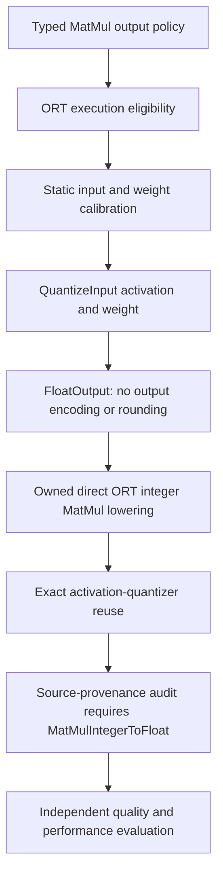

# Integer MatMul with floating outputs

Created: 2026-10-17. Status: implemented, opt-in on the refactor branch.
Author: Vadym Stupakov <vadim.stupakov@gmail.com>.
Authoritative source: `docs/float-matmul-outputs.md` in this repository.

## Objective and evidence

Reduce global-transformer inference overhead while retaining integer learned
projections and small measured task differences. Ordinary output requantization
adds rounding and conversion boundaries before FP32 consumers. The measured
candidate combines integer MatMul with direct FP32 output and exact activation-
quantizer reuse. It preserves 15 integer projections, reduces activation
quantizers to nine, removes standalone dequantizers and restores two QuickGelu
fusions in the saved global-transformer model.

This changes numerical semantics: output requantization disappears. It is not an
exact rewrite of a W8A8 output grid, and activation/weight inputs still round and
clip to their calibrated encodings. For example, an integer accumulator 3 with
activation scale 0.1 and weight scale 0.2 restores approximately 0.06 directly;
a separate output grid with step 0.1 would round that result again to 0.1.

The target is the existing two-layer width-64 Stackformers character transformer,
not a pretrained large language model. Current defaults remain unchanged.

## Typed interface and architecture

```python
from quantsmith import Quantizer
from quantsmith.config import QuantizationConfig
from quantsmith.pipeline import FloatMatMulOutputs

config = QuantizationConfig(matmul_outputs=FloatMatMulOutputs())
quantizer = Quantizer.from_config(config)
```

Use `quantizer.quantize(model_proto).calibrate(iterable)` as before.
`QuantizedMatMulOutputs()` is the default. This policy is independent of
`ProducerOutputs` / `FunctionOutputs`, which choose calibration observation points.
Direct pipelines supply `QuantizationStage(..., matmul_outputs=FloatMatMulOutputs())`
and explicitly compose `ReuseQuantizersStage()` before verification. The built-in
configuration and global-transformer example include that reuse step for this mode.



The pure plan adds `FloatOutput(node, index)`. It requires quantized activation and
weight inputs, conflicts with `QuantizeOutput` on the same output, and cannot share
a revision with smoothing transforms. Saved example JSON uses
`target: "float_output"` without an invented output scale or zero point.

`FloatMatMulQuantizer` is an ORT execution adapter around `StaticW8A8`: it requests
only input statistics, preserves input and weight encodings, and declares the
floating-output operation. Unused output extrema/histograms are not collected.
The numerical algorithm remains independent of ONNX Runtime.

The isolated lowering module consumes the validated input encodings, retains their
quantizers and integer constants, removes only the private decoders created for
that consumer, and emits `com.microsoft::MatMulIntegerToFloat`. It preserves the
source node identity, public output names and shared values. A following bias Add
retains its FP32 graph semantics; ORT may fuse it afterward. No backend abstraction
or runtime string registry is introduced.

The execution audit distinguishes the planned representations: a `FloatOutput`
requires the matching source node to compile to `MatMulIntegerToFloat`. An unrelated
integer node, a floating fallback or a `QLinearMatMul` output is insufficient.
Exact reuse remains a separate existing graph step, not a numerical change.

## Verified restrictions and failures

- Built-in support initially requires standard two-input, one-output MatMul,
  rank-two constant weights, UINT8 activations and symmetric INT8 weights.
- Activation scale/zero point are per-tensor; weight encoding is per output column
  with the static planner's axis 1. Vector, matrix and batched activation layouts
  are tested. Activation zero points can be nonzero.
- Conv/Gemm retain their existing quantized-output paths. Dynamic attention matrix
  products remain FP32; direct-kernel dynamic-weight capability does not implement
  dynamic calibration here.
- Unsupported built-in formats/layouts remain FP32 with explicit eligibility
  reasons. Malformed manual plans return the existing lowering failure rather
  than silently using an alternative representation.
- Custom algorithm decisions remain authoritative; automatic adaptation applies
  to the built-in static method only.
- Reconstruction rejects this policy: learned-code reconstruction has a different
  execution contract and does not currently audit this integer path.
- Default quantization and accepted recipes retain their previous representations.
  No universal accuracy tolerance or automatic promotion rule is added.

## Verification and evidence

The public MinMax and Percentile configurations reproduce the measured experimental
candidate outputs bit for bit across 1,024 contexts / 32,768 tokens each, using
optimized ORT sessions. The global example MinMax graph is byte-identical to the
public facade graph. All 15 learned projections pass the source-provenance audit.
Integration evidence: ignored
`work_dir/artifacts/integrated_global_float_output/parity.json`,
`*.execution.json`, typed `*.plans.json`, serialized configs and graphs.

`just check` passes all 893 tests, Ruff checks/formatting and strict Pyrefly.
The new mode adds 52 regression cases across numerical/boundary tests,
reconstruction rejection and the real global-transformer export.

Tests cover independent integer-accumulation arithmetic, nonzero activation zero
points, per-column scale variation, vector/matrix/batched inputs, shared/public
outputs, bias placement, exact reuse, output-operation conflicts, invalid dtypes,
wrong axes, nonzero weight zero points, invalid output indices, dynamic-weight
exclusions, unsupported operators, source-owner/kernel mismatches, reconstruction
rejection, and composition with candidate selection. A real Stackformers export
covers the public global-transformer recipe. Existing default behavior is covered
by the full regression suite.

## Measured candidate results

The pre-integration ablation used ORT 1.30.0 CPU, one thread, batch one, the same
saved input, 50 warmups and 10,000 unprofiled timed runs in each fresh process.
Two serial sweeps reversed candidate order; separate 100-call profiling sessions
retain optimized graphs and raw ORT JSON. Calibration used 64 contexts; expanded
evaluation used 1,024 contexts from the existing disjoint evaluation span.

| Global transformer | Repeat 1 µs | Repeat 2 µs | ROM KiB | Top-1 % | Perplexity |
| --- | ---: | ---: | ---: | ---: | ---: |
| FP32 | 85.96 | 86.08 | 527.4 | 40.750 | 7.92877 |
| Current INT8 MinMax + reuse | 93.88 | 95.92 | 344.4 | 40.601 | 7.94209 |
| Integer float output + reuse | 86.58 | 86.79 | 308.2 | 40.695 | 7.93785 |

The candidate lowers latency about 8–10% and ROM about 10.5% against the matched
INT8 MinMax baseline, with slightly better measured top-1 and perplexity. Against
FP32 it is close in latency, has about 41.6% smaller serialized storage, top-1 lower
by 0.055 percentage points and perplexity about 0.115% higher. This does not
establish a repeatable faster-than-FP32 result or population-level quality parity.
The public integration is numerically identical on the evaluated contexts;
serialized graph metadata may differ, so integrated file sizes and timings are
measured separately. Process RSS includes initialization and is not isolated
steady-state tensor memory.

Complete ablation: ignored `work_dir/artifacts/global_transformer_gain/README.md`,
`measurements.json`, `quality.json`, `cases.json`, candidate graphs and `repeat_*`
traces. Both original 128-context and expanded 1,024-context metrics are retained;
they use different window selections, so their absolute scores must not be mixed.

## Fresh integrated measurements

The public-API graphs were remeasured after the full verification suite finished,
with the same timing protocol in two serial fresh-process sweeps. The integrated
model omits obsolete output-QDQ metadata, making its file smaller than the earlier
rewrite artifact. Its evaluated outputs are bit-identical to that artifact.

| Variant | Repeat 1 µs | Repeat 2 µs | ROM KiB | Process peak RSS MiB | Integer projections | Q | DQ | QuickGelu |
| --- | ---: | ---: | ---: | ---: | ---: | ---: | ---: | ---: |
| FP32 | 84.08 | 83.33 | 527.4 | 74.0 | 0 | 0 | 0 | 2 |
| Current MinMax + reuse | 91.83 | 90.88 | 344.4 | 74.6 | 15 | 9 | 25 | 0 |
| Current Percentile + reuse | 91.46 | 91.67 | 344.4 | 74.5 | 15 | 9 | 25 | 0 |
| Float output MinMax + reuse | 85.33 | 84.50 | 305.5 | 73.7 | 15 | 9 | 0 | 2 |
| Float output Percentile + reuse | 84.96 | 85.17 | 305.5 | 73.7 | 15 | 9 | 0 | 2 |

In this sweep MinMax latency drops about 7% against current INT8 MinMax/reuse,
with about 11.3% smaller ROM. Against FP32, storage is about 42.1% smaller;
latency is about 1.5% higher. The integrated MinMax task metrics are the verified
candidate values: top-1 40.695%, perplexity 7.93785 versus FP32 40.750%, 7.92877.
No additional inference-memory claim follows from the small process-RSS change.

Evidence under `work_dir/artifacts/integrated_global_float_output/` includes
`measurements.json`, model SHA256 values, both repetitions' reports, optimized
graphs and raw ORT JSON traces, plus the public configs, plans and provenance audits.
The separate original ablation above remains recorded rather than replacing its
measurements with a faster repetition.

## Alternatives and remaining work

Naive Q/DQ removal previously allowed floating Gemm fallback; direct integer
lowering and provenance checks prevent that false integer claim. Joint smoothing
is optional and did not establish a compelling additional benefit over this
simpler candidate. Whole-graph MSE selection remains experimental because its task
regressions are a separate problem.

Future work: additional signedness/scale-layout probes, dynamic operand calibration,
measured selective integer regions, larger trained models and independent task
validation. These require evidence before expanding the verified contract or
changing defaults. See [operator capabilities](ort-capabilities.md) and
[the selection study](output-based-smoothing.md).
