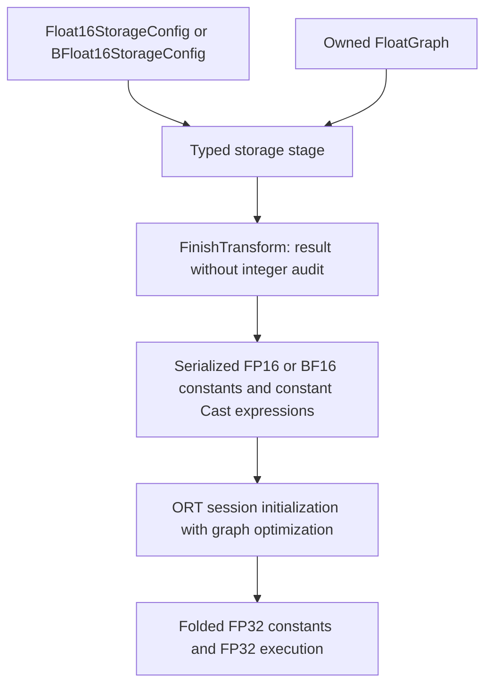

# FP16 and BF16 storage with FP32 execution

Created: 2026-10-17 · Status: implemented on the refactor branch

Author: Vadym Stupakov <vadim.stupakov@gmail.com>

Authoritative source: this repository's `docs/float16-storage.md`.

## Objective and usage

Reduce serialized model size while retaining floating-point execution. Our static
W8A8 captioning decoder had slower integer projections than FP32. This alternative
stores eligible constants in FP16 and restores FP32 once during ORT session
initialization. It needs no calibration and does not claim integer execution.

```python
import onnx
from quantsmith import Quantizer
from quantsmith.config import Float16StorageConfig
from quantsmith.result import Err, Ok

config = Float16StorageConfig(minimum_elements=256)
# JSON equivalent: {"kind": "float16_storage", "minimum_elements": 256}
outcome = Quantizer.from_config(config).quantize(model_proto).calibrate([])
match outcome:
    case Ok(result):
        onnx.save(result.model, "compact.onnx")
    case Err(error):
        raise RuntimeError(error.model_dump_json())
```

For BF16 storage, use the same lifecycle with:

```python
from quantsmith.config import BFloat16StorageConfig

config = BFloat16StorageConfig(minimum_elements=256)
# JSON equivalent: {"kind": "bfloat16_storage", "minimum_elements": 256}
```

Both formats use two bytes per stored value. BF16 has eight exponent bits and
seven fraction bits; FP16 has five exponent bits and ten fraction bits. BF16
therefore retains wider-range values at the cost of coarser rounding. For example,
65,536 fits BF16 exactly but exceeds FP16's finite range. BF16's finite maximum
is slightly smaller than FP32's, so BF16 also needs an overflow guard.

The existing fluent lifecycle executes the transform at `calibrate([])`; it does
not read samples. `Float16StorageConfig` is a separate frozen, strict configuration
boundary; `BFloat16StorageConfig` provides an independent BF16 declaration.
Integer types, smoothing and activation-calibration settings do not
belong to this mode. Existing `QuantizationConfig` behavior is unchanged.

## Pipeline and execution boundary



Both encoders share a pure owned-model rewrite in the ONNX adapter. It restores
original tensor names with constant Cast expressions, preserving consumer dtypes,
shared weights and directly exported initializer names. Name allocation avoids
existing tensor and node identifiers. It adds no algorithm, calibration collector,
backend abstraction or runtime registry. The ordinary transform-only result uses
`Absent` to explain why integer execution was not audited; it has no quantization
plans. The source graph remains owned and unchanged.

**Keep ORT graph optimization enabled**, for example `ORT_ENABLE_ALL`. Added
storage Cast expressions should be folded at session initialization; disabling
optimization can leave conversions in the execution graph. The library does not
promise that every arbitrary graph or future runtime will fold identically.
Tests verify the actual optimized MatMul graph and FP32 output computation.
Inspect the optimized graph for deployment-specific fusion requirements.

Deploy `result.model`, rather than re-saving the optimized runtime graph whose
constants have expanded back to FP32. Saving debug optimized graphs beside the
compact graph is useful for inspection, but they are not required deployment
assets.

## Eligibility and restrictions

Only dense FP32 initializers with at least `minimum_elements` entries are
converted. Other dtypes, empty/small constants, nonfinite constants and values
outside the chosen format's finite range remain unchanged. Each encoder preserves
the whole tensor when any entry exceeds its finite range. BF16 uses round-to-nearest,
ties-to-even and little-endian two-byte codes, without a new runtime dependency.
Rounding can underflow tiny
values to zero and can affect accuracy; evaluate the target task.

The low-level rewrite preserves overridable initializers. The public facade keeps
its existing admission contract: freeze overridable initializers before use,
provide ONNX opset 13 or newer, and use flat graphs without control-flow subgraphs.
Constant attributes and sparse tensors are not compressed by this stage.

This targets ROM. Runtime constants expand to FP32, so lower RAM or faster
arithmetic is not promised. Initialization does extra conversion work; startup
latency has not yet been benchmarked. Model bytes can increase for small tensors,
which is why the size threshold is explicit.

## Experimental evidence and remaining work

On the saved MobileNetV4 + Stackformers captioning checkpoint, a precursor using
this same conversion policy produced:

| Metric | FP32 | FP16 stored, FP32 executed |
| --- | ---: | ---: |
| Encoder + decoder ONNX MiB | 31.041 | 16.287 |
| Caption latency ms, two fresh processes | 12.075 / 12.238 | 11.603 / 11.574 |
| Peak process RSS MiB | 127.50 / 127.56 | 133.08 / 133.30 |
| CIDEr | 0.243301 | 0.243301 |
| BLEU-4 | 0.110714 | 0.110714 |

All 32 evaluated captions matched. All 157 storage Cast expressions disappeared;
optimized encoder and decoder operator histograms matched the FP32 controls.
The integrated configuration reproduces every stored initializer and execution
node of both precursor graphs exactly; normalized shape metadata may differ.
Timing used 20 warmups and 100 measured runs, one CPU thread, unchanged uncached
decoding, serial forward/reverse candidate order. The apparent latency gain is
not an established arithmetic speedup. Evaluation is a bounded 32-image study
using a weakly trained checkpoint and regex caption tokenization, not evidence of
production accuracy equivalence. These measurements concern FP16 storage only.
Generated reports remain under ignored
`work_dir/artifacts/storage_fp16/`.

BF16 storage was evaluated separately on the same checkpoint and 32 held-out
images, with the same one-thread uncached benchmark settings:

| Metric | FP32 control | BF16 stored, FP32 executed |
| --- | ---: | ---: |
| Encoder + decoder ONNX MiB | 31.041 | 16.287 |
| Caption latency ms, two fresh processes | 12.122 / 11.899 | 12.194 / 12.104 |
| Fixed 32-step latency ms | 27.403 / 26.672 | 27.495 / 27.233 |
| Peak process RSS MiB | 127.81 / 127.70 | 133.30 / 133.34 |
| CIDEr | 0.243301 | 0.232028 |
| BLEU-4 | 0.110714 | 0.094637 |

Only 29/32 captions match FP32 with BF16. All storage casts disappear. The
observed timing variation does not establish a speedup or latency equivalence;
BF16 loses caption quality on this bounded subset despite unchanged
teacher-forced token accuracy. FP16 is the better measured storage choice for
this checkpoint. BF16 reports and traces are under ignored
`work_dir/artifacts/storage_bfloat16/`. Wider numeric range does not imply better
task accuracy, and the FP16 quality result must not be attributed to BF16.

TBD: measure initialization costs and broaden held-out task evaluation. This mode
is opt-in and does not change any existing integer quantization default.
