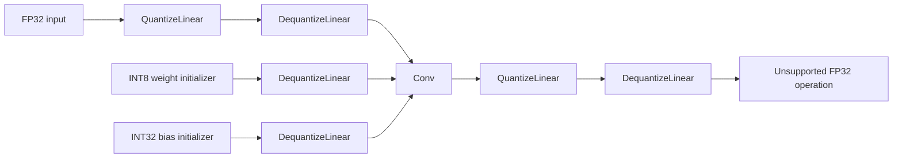
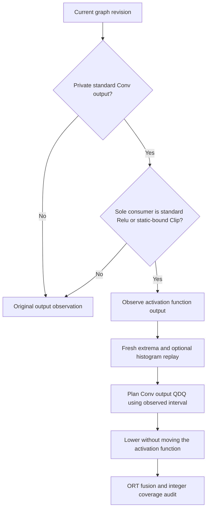

# Verified integer execution on ONNX Runtime CPU

Created: 2026-10-17 · Status: implemented initial CPU contract

Author: Vadym Stupakov <vadim.stupakov@gmail.com>

## Objective

Selected supported weight-bearing operations must compile to integer kernels.
Unsupported operations may remain FP32. A graph with compressed integer weights
and floating-point convolutions does not satisfy this execution contract.

## Representation and boundaries

ORT recognizes a supported complete pattern and replaces the multiplicative
computation with an integer operator such as `QLinearConv`. INT8 operands use
INT32 accumulators. A dequantized public output preserves the FP32 interface to
unsupported consumers and graph outputs. QDQ nodes in the exported graph are not
proof of executed floating-point computation; inspect the compiled graph.

`ExecutionQuantizer` wraps the existing static method in the backend. It asks for
output ranges, and output histograms when that method needs them. Output clipping
uses the selected method, rather than silently forcing MinMax. It appends an
explicit `QuantizeOutput` to the returned plan. Standalone `StaticW8A8` planning
retains its original input/weight contract.

Input and output writes have independent conflict keys. Producer output rounding
affects every consumer of that value, unlike consumer-local `QuantizeInput`.
Source tensor names and model input/output types remain unchanged. Example plan
JSON identifies output records with `target: "output"`.

## Activation-function-aware calibration

Select `outputs=FunctionOutputs()` in the quantization configuration to observe a following
activation function when choosing a built-in static Conv's output encoding.
It is disabled by default and does not change standalone `StaticW8A8`.

For example, a Conv may produce `[-12, 12]` while its following Clip produces
`[0, 6]`. A UINT8 MinMax output scale of `6 / 255` with zero point zero describes
the clipped interval. Applying that encoding before Clip intentionally clips
negative and large values early. It also lets ORT remove intermediate QDQ when
adjacent integer encodings align. Percentile still uses its own interval policy
and histogram replay; it is not replaced with MinMax.

`activation_function_ranges.py` owns pure eligibility and an algorithm decorator.
`execution_rules` applies it only to admitted built-in execution quantizers.
Public or multiply-consumed Conv outputs, custom domains, other functions, and
Clip bounds supplied at runtime (including overridable initializers) are skipped.
The post-function tensor can itself be public or shared: it retains its interface.
Both extrema and histogram requests use the transformed graph revision. SmoothQuant
therefore still lowers its rescaling before collecting fresh static statistics.
Caller-owned graphs and statistics are not mutated.

This is a calibration policy that changes clipping and rounding, not an equivalent
graph rewrite. Fusion and accuracy gains are not guaranteed. On the same 128-image
calibration / 256-image held-out Imagenette selection, seed 42, one thread,
ORT 1.30.0 CPUExecutionProvider with ORT_ENABLE_ALL:

| MobileNetV2 | Median ms | Top-1 % | ONNX KiB | Process peak RSS MiB |
|---|---:|---:|---:|---:|
| FP32 | 4.46 | 64.06 | 13882.5 | 117.1 |
| Existing MinMax | 3.76 | 58.59 | 4031.6 | 108.2 |
| Activation-function-aware MinMax | 2.78 | 63.67 | 4031.6 | 101.8 |
| Existing SmoothQuant | 4.22 | 61.33 | 4065.5 | 109.1 |
| Activation-function-aware SmoothQuant | 3.20 | 64.84 | 4065.5 | 102.8 |

All 52 convolutions remain integer. MinMax's compiled QuantizeLinear and
DequantizeLinear counts each fall from 36 to 2. Separate raw ORT traces show
conversion work dropping while convolution time stays similar. Timings use
50 warmups and 300 unprofiled runs; two fresh-process repetitions in opposite
orders confirm the improvement. Profiling occurs separately (100 runs).
RSS includes startup, serialization and inference; it is not steady-state tensor
RAM. Small held-out accuracy differences do not establish population gains.

Percentile improves from 3.80 to 2.78 ms but top-1 drops from 63.67% to 61.72%.
ResNet18 changes little; EfficientNetB0 has no eligible functions here and is
unchanged. The integrated MobileNetV2 recipes produce byte-identical graphs to
these experimental candidates. Local evidence lives under
`work_dir/artifacts/execution_options/` and
`work_dir/artifacts/integration_activation_function/`; generated artifacts are
not shipped. Shared encoding search and integer MatMul with float output remain
separate, unintegrated experiments.

A fresh profiling and held-out evaluation run of the integrated library gives
FP32 4.54 ms / 64.06%, MinMax 2.75 ms / 63.67%, Percentile 2.79 ms / 61.72%,
and SmoothQuant 3.20 ms / 64.84%. Separate profiling sessions retain the same
integer coverage and conversion reduction. All 556 tests, Ruff and strict
Pyrefly checks pass, including 26 activation-function-aware regression cases.

## Bias correctness

The accumulator scale is activation scale multiplied by per-output-channel weight
scale. Bias codes are rounded to INT32 with zero point zero. When a tiny or zero
weight channel would make its bias overflow, the execution adapter increases that
channel's weight scale before generating either weight or bias codes. A small
safety margin accounts for floating-point rounding at the INT32 limit. The adjusted
weight encoding is included in the plan. Unsafe or unrepresentable numerical
conversions fail explicitly rather than wrapping or silently clipping bias codes.

The original bias remains untouched, including when other consumers share it.
Unused original initializers are pruned after lowering.

## Initial support and fallback policy

| Operation/configuration | Contract |
| --- | --- |
| Conv | Constant rank 3/4/5 weights; ordinary, grouped and depthwise; constant vector bias when present |
| Gemm | Constant rank-two weights; all transA/transB combinations; alpha=beta=1; constant vector bias when present |
| MatMul | Constant rank-two weights; per-output-channel weight encoding |
| UINT8 residual Add | Connected supported ancestry; calibrated inputs and output; explicit exclusions respected |
| Signed residual Add | Outside the automatic boundary contract; may remain FP32 |
| Relu, Clip, Sigmoid, pooling, normalization, dynamic-weight MatMul | No independent integer guarantee; may remain FP32 or be fused by ORT |
| Weight encodings | Symmetric INT8 or UINT8; signed activations require signed weights |
| Custom algorithms and reconstruction | No automatic completion guarantee in this initial implementation |

Other static layouts are excluded before planning, with a reason in the execution
report. This preserves their original weights, avoiding compact integer weights
feeding a known floating fallback. Numerical faults in an admitted layout and
unexpected failures to obtain its integer kernel return errors instead of silently
changing the selection.

Residual boundaries are added for static UINT8 regions even without SmoothQuant.
They default to MinMax to preserve existing graphs. Set
`boundary_calibration=FollowCalibration()` to follow the main interval method, or
pass `MinMaxConfig()` / `PercentileConfig(percentile=...)` explicitly. Boundary
Percentile collects fresh histograms on the current graph revision. Direct typed
pipelines accept `QuantizationStage(..., boundary_calibration=Percentile(...))`.
These boundaries remain asymmetric UINT8; changing the interval policy does not
introduce per-channel activation encoding. Additional rounding is not numerically equivalent
to previous releases. Unsupported FP32 consumers can receive quantized-and-restored
values from upstream integer regions.

## Verification and result API

`QuantizationResult.execution` contains an `ExecutionReport` for the static pipeline:

- ORT runtime version and CPU provider identity;
- source identity, source operator, compiled integer operator and domain;
- nodes outside the verified selection, with exclusion/unsupported reasons.

The audit privately creates an optimized CPU session and loads its optimized graph.
It requires a matching integer kernel for every planned producer output. It does
not accept an unrelated integer node as evidence. Missing or ambiguous matches
return an execution failure. Exact source names and recognized ORT layout suffixes
are used for provenance; unknown naming transformations fail closed.

Temporary optimized artifacts are deleted. Callers must use equivalent optimized
CPU settings for the audited behavior; calibration sessions intentionally disable
optimization and are not deployment sessions. Structural compilation evidence does
not measure per-node time, task accuracy or hardware instructions.

The three pretrained vision examples save `<variant>.execution.json` alongside
model and plan files. Reconstruction exposes `Absent(reason=...)`, not a false
execution claim.

## Tests and observed outcomes

Tests exercise actual CPU compilation and inference for MatMul, all Gemm transpose
combinations, biased convolution, spatial Conv ranks one through three, grouped and
depthwise kernels, signed/unsigned encodings, residual Add, FP32 Sigmoid boundaries,
dynamic-weight fallback, output conflicts, source ownership and zero-weight bias
channels. A deliberately floating compiled graph must fail the coverage audit.

Local before/after experiments use 128 calibration images, 256 held-out Imagenette
images, seed 42, batch one, one CPU thread and 300 timed inferences. Results are
observations on an arm64 Mac with ORT 1.30.0, not general accuracy or speed targets.
The baseline refers to QuantSmith 0.8.4. Generated evidence stays under
`work_dir/artifacts/integer_execution/` and is not committed.

| Model/method | Before median ms | New median ms | Before top-1 | New top-1 |
| --- | ---: | ---: | ---: | ---: |
| ResNet18 MinMax | 28.59 | 9.52 | 67.58% | 66.41% |
| ResNet18 Percentile | 28.73 | 9.51 | 67.19% | 67.19% |
| ResNet18 SmoothQuant | 9.61 | 9.80 | 66.41% | 67.19% |
| MobileNetV2 MinMax | 3.40 | 3.75 | 63.28% | 58.59% |
| MobileNetV2 Percentile | 3.38 | 3.79 | 62.50% | 63.67% |
| MobileNetV2 SmoothQuant | 3.41 | 4.41 | 64.84% | 61.33% |
| EfficientNetB0 MinMax | 13.32 | 8.53 | 44.92% | 28.52% |
| EfficientNetB0 Percentile | 13.31 | 8.57 | 69.53% | 64.84% |
| EfficientNetB0 SmoothQuant | 13.62 | 8.99 | 45.31% | 30.08% |

All 20 ResNet18, 52 MobileNetV2 and 81 EfficientNetB0 convolutions now pass integer
coverage for all three methods, along with their classifiers and connected
UINT8 residual Adds. The new ResNet18 FP32 baseline is
4.54 ms, so integer execution still loses to FP32 there. MobileNetV2 demonstrates
that stronger integer coverage can worsen latency and accuracy. Output rounding,
activation fusion and scale alignment need further investigation. Small accuracy
differences on this subset do not establish population-level improvements.
EfficientNetB0 is faster but its MinMax and SmoothQuant accuracy losses are severe;
these candidates are not evidence of acceptable task quality.

Fresh inference-only processes also measured these cumulative RSS high-water marks:

| Model | FP32 peak MiB | MinMax peak MiB | Percentile peak MiB | SmoothQuant peak MiB |
| --- | ---: | ---: | ---: | ---: |
| ResNet18 | 213.6 | 123.1 | 123.2 | 123.6 |
| MobileNetV2 | 116.6 | 107.7 | 107.6 | 108.7 |
| EfficientNetB0 | 142.0 | 132.8 | 133.6 | 135.1 |

The same seeded synthetic FP32 input, ten warmups and thirty runs are used by
`profile_runtime`. The peak includes Python, NumPy, ORT, initialization, optimized
graph serialization and inference. It is not steady-state tensor memory. New
quantized ROM is about 11.36–11.37 MiB, 3.94–3.97 MiB and 6.23–6.29 MiB for the
three models respectively; extra boundary metadata slightly increases files.

## Restrictions and TBD

1. **Latency:** reduce conversion boundaries, improve scale sharing and inspect
   kernel/packing costs. Integer coverage is an acceptance condition for execution,
   not a latency acceptance threshold.
2. **Activation fusion:** output QDQ can interrupt existing specialized
   Conv/Clip/smoothing rewrites. Clip may remain FP32; preserving efficient integer
   clipping with complete producer boundaries remains restricted to eligible
   patterns. Activation-function-aware calibration can restore fusion for private
   Relu/Clip edges; shared outputs and other activation functions remain open work.
3. **RAM:** measure initialization peak, steady-state residency and temporary
   buffers separately. Serialized model size is not runtime memory traffic.
4. **Accuracy:** evaluate activation-function-aware output encodings on larger
   held-out data. Keep calibration, tuning and final evaluation data separate.
5. **Providers/versions:** verify other devices and runtime builds; benchmark the
   actual deployment session. No GPU/CoreML guarantee is implied.
6. **Search:** Optuna or a graph optimizer can explore verified transformations
   later; it is not needed to establish integer execution.

## References and alternatives

ORT supplies the fusion and kernels; QuantSmith supplies complete patterns and
checks the result. Direct QOperator emission is a future alternative if measured
beneficial; replacing node names alone does not create a faster kernel.

- [ORT quantization and debugging](https://onnxruntime.ai/docs/performance/model-optimizations/quantization.html)
- [ORT QDQ Conv fusion](https://github.com/microsoft/onnxruntime/blob/main/onnxruntime/core/optimizer/qdq_transformer/selectors_actions/qdq_selector_action_transformer.cc)
- [ORT bias scale adjustment](https://github.com/microsoft/onnxruntime/blob/main/onnxruntime/python/tools/quantization/qdq_quantizer.py)
- [Integer-only inference, Jacob et al.](https://openaccess.thecvf.com/content_cvpr_2018/html/Jacob_Quantization_and_Training_CVPR_2018_paper.html)
- [HAWQ-V3: execution and hardware-aware precision](https://proceedings.mlr.press/v139/yao21a.html)
- [SmoothQuant: offline rescaling and efficient kernels](https://proceedings.mlr.press/v202/xiao23c.html)
