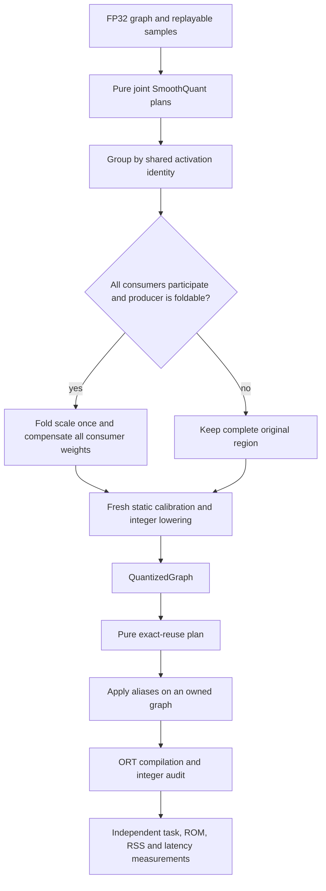

# Joint smoothing and exact quantizer reuse

Created: 2026-10-17 · Status: implemented as explicit pipeline choices; accepted
model recipes retain their previous declarations.

Author: Vadym Stupakov <vadim.stupakov@gmail.com>

Authoritative source: this repository's `docs/joint-smoothing.md`.

## Objective and background

Reduce executed smoothing and quantization work while keeping integer projections
and measuring task quality independently. Earlier runtime SmoothQuant adds scaling
kernels; independent fold-only smoothing skips shared normalization outputs when
consumers choose different channel scales. Both saved Stackformers graphs have
shared Q/K/V inputs and paired feed-forward inputs.

Two changes address different costs:

1. **Joint SmoothQuant:** derive a common channel vector from compatible siblings'
   weight maxima, then fold the complete consumer group into its affine producer.
   This changes subsequent INT8 encodings and may change accuracy.
2. **Exact quantizer reuse:** execute identical private QuantizeLinear operations
   once. Require the same source, serialized scale/zero-point representations,
   and attributes. This preserves encoding grids and removes repeated work.

These choices do not promise faster FP32-to-INT8 conversion or faster integer
matrix kernels. Their purpose is to remove unnecessary executed operations.

## Architecture and interfaces



```python
from quantsmith import Quantizer
from quantsmith.config import JointSmoothQuantConfig, QuantizationConfig

config = QuantizationConfig(smoothing=JointSmoothQuantConfig(alpha=0.5))
outcome = Quantizer.from_config(config).quantize(model_proto).calibrate(dataset)
```

This declaration compiles to transform → static quantization → exact reuse → audit.
Ordinary MinMax, Percentile and independent SmoothQuant declarations are unchanged.
For exact reuse with a custom static pipeline:

```python
from quantsmith.algorithms.static import StaticW8A8
from quantsmith.backends.onnx.stages import (
    QuantizationStage,
    ReuseQuantizersStage,
    VerifyStage,
)
from quantsmith.config import supported
from quantsmith.pipeline import Pipeline

program = (
    Pipeline(QuantizationStage(supported(StaticW8A8())))
    .then(ReuseQuantizersStage())
    .then(VerifyStage())
)
outcome = Quantizer.from_pipeline(program).quantize(model_proto).calibrate(dataset)
```

`ReuseQuantizersStage` is a `QuantizedGraph → QuantizedGraph` transition using the
existing Step protocol. It adds no backend abstraction or plugin registry.
The final audit checks the rewritten graph. Source-oriented numerical plans are
retained because exact reuse changes neither rounding nor encoding parameters.

The reuse planner reads the graph and returns immutable alias records. Application
edits only an owned graph, rewires consumers and removes obsolete private metadata
and unused initializers. Fingerprinting is restricted to referenced quantization
encodings; it does not serialize model weights. Dynamic encodings, omitted zero
points, custom-domain quantizers and public quantizer outputs remain untouched.
Numerically equal grids with different serialized representations are conservatively
left separate. Plans are bound by contract to the graph revision being rewritten.

Joint folding requires equal scales and axes and complete participation in every
use of the activation. A conflicting or excluded consumer blocks the complete
group. Public values, unsupported broadcasting, nonlinear barriers, and shared
intermediate values on a producer path prevent folding. Supported affine producers
and positive Relu propagation follow the existing fold-only policy. See the
[joint algorithm guide](../src/quantsmith/algorithms/smoothquant/joint/README.md).

## Experiment design

Use the existing saved FP32 checkpoints; do not retrain or change architecture.
Compare FP32, accepted MinMax/Percentile/runtime-SmoothQuant, independent fold-only
smoothing plus MinMax/Percentile, and joint fold-only smoothing plus those methods.
Isolate exact reuse in a second ablation, then rebuild the integrated public facade.

ORT 1.30.0, CPUExecutionProvider, ORT_ENABLE_ALL, one intra/inter-op thread, batch one.
Each timing worker is a fresh process: 50 warmups, 300 image or 1000 token runs.
A separate profiling session records 100 runs in raw ORT JSON traces. Profiled
operator durations include profiling overhead and are not unprofiled wall time.
Independent process repetitions reverse candidate order.

CNNs use pretrained TorchVision ResNet18, MobileNetV2 and EfficientNet-B0 with 128
seeded Imagenette training images for calibration and 256 held-out images, seed 42.
The global/windowed Stackformers checkpoints have two layers, width 64, four heads,
sequence length 32, and were trained for 600 steps. Calibration uses 64 contexts;
evaluation uses 128 contexts / 4096 next-token targets. They are small trained
language models, not pretrained large language models. Windowed attention exports
dense masked attention. No evaluation examples are used to choose alpha; all joint
candidates use 0.5.

ROM is serialized ONNX bytes. RSS is the fresh-process cumulative high-water mark
including initialization and inference, not isolated tensor RAM, steady-state
memory, or quantization workspace. Quality changes on these subsets do not establish
population-level accuracy improvements. No universal acceptance threshold is used.

## Observations and decision

Joint smoothing folds **11 of 15** selected transformer edges, versus **1 of 15**
for independent folding. Four non-affine paths remain unchanged. Runtime scaling
kernels fall from 15 QLinearMul to zero. Both variants retain all 15 integer learned
projections, four floating dynamic attention products, and two floating Softmaxes.

Without exact reuse, all three quantized transformer methods still execute 15
activation quantizers. Six repeat identical inputs and grids. Reuse reduces this
to **9**, while retaining **15 QLinearMatMul** kernels. Integrated MinMax and
Percentile joint graphs produce bit-identical optimized outputs to their unshared
joint controls on all 128 held-out contexts: maximum absolute difference **0**.
This equality concerns exact reuse; joint smoothing itself changes the numerical
quantization result.

CNN joint folding accepts the same regions as independent folding in this
experiment: 8 ResNet18, 2 MobileNetV2 and 2 EfficientNet-B0 edges. Small latency
changes do not justify accuracy losses. In particular, EfficientNet Percentile
falls from 64.84% to 63.28%; MobileNet Percentile falls from 63.67% to 63.28%.
Those recipes are not promoted. ResNet integer inference remains slower than FP32.

Joint transformer smoothing approaches ordinary static latency. Repeated global
joint measurements show no stable additional advantage over MinMax; windowed joint
measurements improve latency but reduce token top-1. Exact reuse with plain static
methods gives small reductions while preserving their logits. The complete quantized
transformer remains slower than FP32. Perplexity and top-1 can move in different directions: windowed joint MinMax
improves perplexity but reduces token top-1, so it is not an across-metric win.

The implementation remains available through explicit typed choices; existing
accepted recipes and defaults are unchanged. Select a candidate only after reviewing
the corresponding task and performance observations. No automatic method selection,
accuracy tolerance, or silent regression acceptance is introduced.

## Verification and TBD

All 703 tests pass, with Ruff formatting/checks and strict Pyrefly passing. Tests
cover the worked joint-scale example, alpha endpoints, dead/malformed
channels, declaration-order invariance, ownership, complete-group rollback,
shared weights, nonlinear/public/excluded barriers, fresh calibration, exact
reuse rounding/clipping and its incompatibility guards. Real Torch exports cover
both Stackformers models and the three CNNs. Static tests reject a reuse step
before quantization. Compilation audits run after the integrated rewrite.

TBD: larger held-out evaluation, broader affine propagation, shared scales across
compatible axis spellings, and better integer/floating region choices. Existing
float-output integer MatMul experiments are separate; this change does not alter
matrix-output rounding or introduce new nonlinear quantized kernels.

Raw graphs, execution reports, profile traces, manifests, repeat reports and task
scores are retained locally under `work_dir/artifacts/joint_smoothing/`. Experimental
construction/verification scripts are retained in `work_dir/`; generated model and
data artifacts are not committed. The tables below retain regressions as well as
improvements.

## Full independent versus joint folding results

`int8_smoothquant` is the accepted runtime-scaling recipe. `fold_*` means
independent fold-only smoothing; `joint_*` means joint folding without quantizer
reuse, to isolate the smoothing algorithm.

| Model | Variant | Median ms | ROM KiB | Peak RSS MiB | Top-1 % | Perplexity |
| --- | --- | ---: | ---: | ---: | ---: | ---: |
| transformer | onnx_fp32 | 0.0874 | 527.4 | 74.0 | 41.06 | 7.9636 |
| transformer | int8_minmax | 0.0965 | 345.5 | 74.0 | 40.94 | 7.9762 |
| transformer | int8_percentile | 0.0953 | 345.5 | 74.0 | 40.60 | 7.9658 |
| transformer | int8_smoothquant | 0.1043 | 355.6 | 74.4 | 40.99 | 7.9850 |
| transformer | fold_minmax | 0.0953 | 345.3 | 74.0 | 40.94 | 7.9834 |
| transformer | fold_percentile | 0.0960 | 345.3 | 74.2 | 40.77 | 7.9651 |
| transformer | joint_minmax | 0.0957 | 344.5 | 74.2 | 40.94 | 7.9739 |
| transformer | joint_percentile | 0.0958 | 344.5 | 74.0 | 40.72 | 7.9698 |
| windowed_transformer | onnx_fp32 | 0.0850 | 532.7 | 73.7 | 40.92 | 7.9329 |
| windowed_transformer | int8_minmax | 0.0940 | 350.7 | 74.0 | 41.02 | 7.9579 |
| windowed_transformer | int8_percentile | 0.0946 | 350.7 | 73.9 | 41.02 | 7.9478 |
| windowed_transformer | int8_smoothquant | 0.1022 | 360.9 | 74.4 | 40.94 | 7.9541 |
| windowed_transformer | fold_minmax | 0.0939 | 350.5 | 74.0 | 40.97 | 7.9589 |
| windowed_transformer | fold_percentile | 0.0944 | 350.5 | 74.1 | 40.89 | 7.9441 |
| windowed_transformer | joint_minmax | 0.0950 | 349.7 | 74.0 | 40.77 | 7.9406 |
| windowed_transformer | joint_percentile | 0.0940 | 349.7 | 73.9 | 40.80 | 7.9400 |
| resnet18 | onnx_fp32 | 4.4181 | 45733.3 | 213.1 | 66.02 | — |
| resnet18 | int8_minmax | 9.5165 | 11629.8 | 123.3 | 66.41 | — |
| resnet18 | int8_percentile | 9.5134 | 11629.8 | 123.2 | 67.19 | — |
| resnet18 | int8_smoothquant | 9.8209 | 11647.0 | 123.8 | 67.19 | — |
| resnet18 | fold_minmax | 9.5161 | 11630.4 | 123.4 | 66.80 | — |
| resnet18 | fold_percentile | 9.5298 | 11630.4 | 123.1 | 66.80 | — |
| resnet18 | joint_minmax | 9.5244 | 11630.4 | 123.3 | 66.80 | — |
| resnet18 | joint_percentile | 9.5313 | 11630.4 | 123.2 | 66.80 | — |
| mobilenet_v2 | onnx_fp32 | 4.3875 | 13882.5 | 116.8 | 64.06 | — |
| mobilenet_v2 | int8_minmax | 3.7599 | 4031.6 | 107.9 | 58.59 | — |
| mobilenet_v2 | int8_percentile | 3.8010 | 4031.6 | 107.4 | 63.67 | — |
| mobilenet_v2 | int8_smoothquant | 4.2340 | 4065.5 | 109.0 | 61.33 | — |
| mobilenet_v2 | fold_minmax | 3.7575 | 4032.2 | 107.5 | 58.20 | — |
| mobilenet_v2 | fold_percentile | 3.8091 | 4032.2 | 108.2 | 63.28 | — |
| mobilenet_v2 | joint_minmax | 3.7561 | 4032.2 | 107.8 | 58.20 | — |
| mobilenet_v2 | joint_percentile | 3.7950 | 4032.2 | 107.8 | 63.28 | — |
| efficientnet_b0 | onnx_fp32 | 11.6925 | 21214.9 | 142.3 | 75.00 | — |
| efficientnet_b0 | int8_minmax | 8.5276 | 6384.0 | 132.7 | 28.52 | — |
| efficientnet_b0 | int8_percentile | 8.5924 | 6384.0 | 132.9 | 64.84 | — |
| efficientnet_b0 | int8_smoothquant | 8.9991 | 6445.0 | 134.9 | 30.08 | — |
| efficientnet_b0 | fold_minmax | 8.5177 | 6384.6 | 132.7 | 26.17 | — |
| efficientnet_b0 | fold_percentile | 8.5466 | 6384.6 | 132.9 | 63.28 | — |
| efficientnet_b0 | joint_minmax | 8.5056 | 6384.6 | 133.0 | 26.17 | — |
| efficientnet_b0 | joint_percentile | 8.5296 | 6384.6 | 133.2 | 63.28 | — |

## Integrated joint method with exact reuse

| Model | Variant | Median ms | ROM KiB | Peak RSS MiB | Top-1 % | Perplexity |
| --- | --- | ---: | ---: | ---: | ---: | ---: |
| transformer | integrated_joint_minmax | 0.0922 | 343.3 | 73.8 | 40.94 | 7.9739 |
| transformer | integrated_joint_percentile | 0.0910 | 343.3 | 74.0 | 40.72 | 7.9698 |
| windowed_transformer | integrated_joint_minmax | 0.0912 | 348.5 | 74.2 | 40.77 | 7.9406 |
| windowed_transformer | integrated_joint_percentile | 0.0936 | 348.5 | 74.1 | 40.80 | 7.9400 |

## Exact reuse with existing static methods

These candidates use no smoothing. All four preserve optimized FP32 logits
bit for bit against their corresponding accepted MinMax/Percentile model across
128 held-out contexts. Their top-1 and perplexity are consequently unchanged.
Quantizers fall from 15 to 9; all 15 learned projections remain integer.

| Model | Variant | Median ms | ROM KiB | Peak RSS MiB | Top-1 % | Perplexity |
| --- | --- | ---: | ---: | ---: | ---: | ---: |
| transformer | integrated_static_minmax | 0.0949 | 344.4 | 74.0 | 40.94 | 7.9762 |
| transformer | integrated_static_percentile | 0.0922 | 344.4 | 73.8 | 40.60 | 7.9658 |
| windowed_transformer | integrated_static_minmax | 0.0921 | 349.6 | 73.9 | 41.02 | 7.9579 |
| windowed_transformer | integrated_static_percentile | 0.0935 | 349.6 | 74.0 | 41.02 | 7.9478 |

## Fresh-process timing repetitions

Candidates run serially; repeat 2 reverses order. These are independent
repetitions, not confidence intervals. Small effects require more representative
workloads before claiming a general speedup.

### Joint method and its controls

| Model | Variant | Repeat 1 ms | Repeat 2 ms |
| --- | --- | ---: | ---: |
| transformer | onnx_fp32 | 0.0827 | 0.0834 |
| transformer | int8_minmax | 0.0938 | 0.0938 |
| transformer | int8_smoothquant | 0.1028 | 0.1027 |
| transformer | joint_minmax | 0.0939 | 0.0934 |
| windowed_transformer | onnx_fp32 | 0.0863 | 0.0853 |
| windowed_transformer | int8_minmax | 0.0961 | 0.0962 |
| windowed_transformer | int8_smoothquant | 0.1039 | 0.1047 |
| windowed_transformer | joint_minmax | 0.0958 | 0.0948 |
| transformer | integrated_joint_minmax | 0.0938 | 0.0936 |
| windowed_transformer | integrated_joint_minmax | 0.0915 | 0.0921 |

### Lossless static reuse and its controls

| Model | Variant | Repeat 1 ms | Repeat 2 ms |
| --- | --- | ---: | ---: |
| transformer | onnx_fp32 | 0.0832 | 0.0835 |
| transformer | int8_minmax | 0.0965 | 0.0948 |
| transformer | int8_percentile | 0.0951 | 0.0940 |
| windowed_transformer | onnx_fp32 | 0.0855 | 0.0862 |
| windowed_transformer | int8_minmax | 0.0967 | 0.0952 |
| windowed_transformer | int8_percentile | 0.0964 | 0.0962 |
| transformer | integrated_static_minmax | 0.0938 | 0.0935 |
| transformer | integrated_static_percentile | 0.0939 | 0.0936 |
| windowed_transformer | integrated_static_minmax | 0.0941 | 0.0940 |
| windowed_transformer | integrated_static_percentile | 0.0926 | 0.0917 |

## Evidence files

Local `work_dir/artifacts/joint_smoothing/` retains:

- `cases.json`, `folding.json`, `scores.json`: the complete 40-case first ablation.
- `integration_cases.json`, `integration_scores.json`, `integration_parity.json`:
  public Joint SmoothQuant facade builds, task scoring and exact-reuse parity.
- `static_reuse_cases.json`, `static_reuse_scores.json`, `static_reuse_parity.json`:
  public static pipelines with exact reuse and bit-identical control outputs.
- `integration_repeats.json`, `static_reuse_repeats.json`: independent repeats.
- `fingerprints.json`: SHA-256 identities of integrated graphs and fixed inputs.
- Every `profile_*`, `integration_repeat_*`, and `static_repeat_*` directory:
  `report.json`, optimized ONNX graph, worker log, and raw `ort_*.json` traces.
- Per-candidate `*.execution.json`: post-rewrite compiled integer coverage.

Construction and verification scripts are `work_dir/benchmark_joint_smoothing.py`,
`work_dir/verify_joint_integration.py`, `work_dir/verify_static_reuse.py`,
`work_dir/repeat_integrated_joint.py`, and `work_dir/repeat_static_reuse.py`.
They consume the saved checkpoints and cached data described above; they are local
experiment artifacts, not installed package entry points.

## Per-channel histogram follow-up

The [channel histogram study](channel-histograms.md) adds explicit percentile and
histogram-MSE range policies with bounded streaming collection. It separates
per-channel statistics from the final per-tensor activation encoding and retains
all five-model results, including accuracy regressions. The earlier extrema-only
measurements above remain the baseline for that follow-up.
