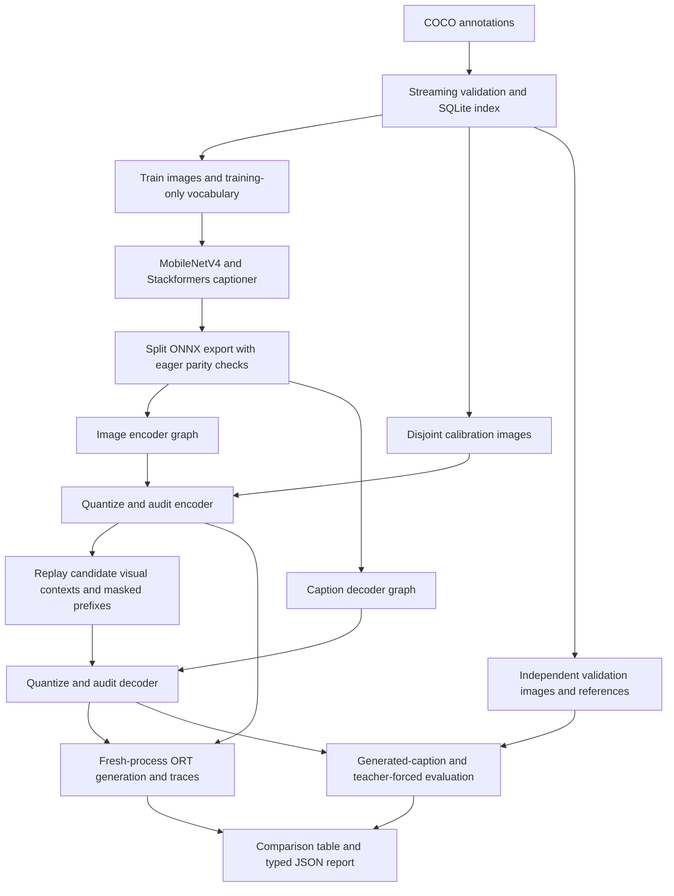

# Mobile image captioning: model and optimization design

Created: 2026-10-17 · Status: implemented; experiment results below

Author: Vadym Stupakov <vadim.stupakov@gmail.com>

## Objective and background

Exercise quantization on one workload containing a mobile CNN, global visual
self-attention, causal text self-attention, and visual/text cross-attention. Measure
complete caption generation, serialized model storage, process memory, and generated
caption quality against the same FP32 checkpoint.

An integer kernel does not guarantee an end-to-end gain: quantization boundaries,
remaining floating attention, and repeated autoregressive work also consume time.
The earlier global Transformer benchmark motivated testing float-output integer
projections alongside conventional quantized-output projections.

## Architecture and ownership

`examples/mobile_captioning/model.py` contains the numerical model. Its encoder
uses timm's pretrained `mobilenetv4_conv_small.e2400_r224_in1k` spatial features,
a linear projection, learned row/column positions, and a noncausal Stackformers
encoder. At 224×224 the feature grid is 7×7 with 960 channels. Learned 2D positions
replace the encoder preset's text RoPE. The causal decoder retains Stackformers'
text RoPE, RMSNorm, SwiGLU, and cross-attention.

`data.py` owns streaming JSON admission, disk indexing, bounded image caching,
tokenization, and minibatch construction. `training.py` uses the existing PyTorch
AdamW implementation and saves ordinary model state dictionaries. `export.py`
declares experiment policies and invokes the existing QuantSmith facade. `inference.py`
keeps greedy decoding independent of model loading and training. `quality.py` and
`benchmark.py` own task scoring and fresh-process measurements respectively.
`main.py` connects these steps explicitly. The library's public API and defaults
are unchanged; this example introduces no backend or optimizer framework.

The image encoder executes once per caption. Its FP32 context remains owned by the
generation call and is reused by every decoder call. Encoder and decoder model bytes
are summed for ROM reporting. The vocabulary and config are separate metadata;
reported ROM is the two ONNX files, not the full distribution package.

## Optimization experiment

| Candidate | Calibration | Conv activation-function observation | MatMul output |
| --- | --- | --- | --- |
| FP32 | none | none | FP32 |
| MinMax | extrema | producer output | quantized |
| Percentile | histogram 99.99% | producer output | quantized |
| Function MinMax | extrema | eligible Relu/Clip output | quantized |
| Float MinMax | extrema | eligible Relu/Clip output | FP32 from integer accumulation |
| Float Percentile | histogram 99.99% | eligible Relu/Clip output | FP32 from integer accumulation |
| Encoder-only MinMax | extrema in encoder | eligible Relu/Clip output | encoder integer/float output; decoder FP32 |
| Encoder-only Percentile | histogram 99.99% in encoder | eligible Relu/Clip output | encoder integer/float output; decoder FP32 |
| CNN-only MinMax | extrema in convolutions | eligible Relu/Clip output | all MatMul remains FP32 |
| CNN-only Percentile | histogram 99.99% in convolutions | eligible Relu/Clip output | all MatMul remains FP32 |

Weights use per-output-channel symmetric INT8; activations use asymmetric
per-tensor UINT8. Unsupported operations retain FP32. The existing ORT audit must
verify the selected source operators execute with the expected integer kernels.
Float-output mode also enables exact activation-quantizer reuse. It changes output
rounding and is evaluated as a separate numerical candidate.

Hypothesis: function-output calibration can avoid unnecessary CNN output boundaries;
float-output integer projections can reduce Transformer requantization and preserve
floating fusion opportunities. Expect smaller ONNX files. Latency, process RSS, and
caption quality require measurements and may regress. No candidate changes defaults
or becomes a winner solely because it has more integer nodes.

Encoder-only and CNN-only candidates explicitly declare `KeepFloat()` for the decoder;
its bytes are copied unchanged and its full size counts toward ROM. CNN-only selection
composes the existing `Rules` and `QuantizationStage` to select `Conv`, preserving both
visual and text Transformers in FP32. These are explicit experiment choices, without
automatic fallback. They test whether convolution gains survive without the measured
integer-projection regression in repeated decoder execution.
Connected CNN residual additions may also compile to `QLinearAdd` when the integer
boundary completion and ORT fusion make that possible.

Encoder calibration uses disjoint training images. Decoder calibration runs that
candidate's encoder, then replays prefixes of lengths 1, 4, 8, and the configured
buffer length, deduplicated and bounded by the buffer size. Histogram passes recreate
the same image, prefix, and context values; activations are not retained across images.

## Measurement contract and restrictions

- Batch one, fixed image geometry and caption buffer. Both ORT graphs use final
  `ORT_ENABLE_ALL` optimization, one inter-op thread, and the configured intra-op count.
- Time encoder, one BOS-prefix decoder call, complete EOS-terminated generation,
  and generation forced to the same maximum step count. Repeat in fresh processes
  in forward and reverse variant order. Timing sessions have profiling disabled.
- Record process RSS high-water marks before sessions, after session creation, and
  after inference. These include ORT, initialization, and allocator effects; they
  are not isolated tensor workspace measurements.
- Collect raw ORT traces in separate sessions afterward, preserving optimized graphs
  and per-source integer audit evidence. Traces can establish executed operators and
  observed costs; counts alone cannot establish causality.
- Score generated captions with upstream COCO CIDEr and BLEU-4 scorers. The shared
  lowercase regex word/punctuation tokenizer differs from official PTB tokenization;
  scores support matched internal comparisons, not published leaderboard equivalence.
- Track teacher-forced token accuracy, cross-entropy, unknown-target fraction, generated
  lengths, and all generated examples. Token metrics alone do not establish caption quality.
- Training and calibration stream image records. Official COCO metric implementations
  retain the configured evaluation subset, explicitly capped at 5,000 images. Metadata
  and training vocabulary counting use disk-backed SQLite instead of full JSON trees.
- ImageNet initializes only MobileNetV4. The new encoder/decoder must learn captioning.
  A bounded smoke run is not a trained production captioner or an accuracy guarantee.

## Open work and alternatives

Stackformers 4.6 has no incremental KV-cache/decode-step API. Consequently, the
decoder recomputes the entire padded buffer, visual key/value projections, and
vocabulary logits each step. Add caching in Stackformers before exposing it here;
do not introduce a separate handwritten attention implementation in QuantSmith.
Dynamic prefixes, projecting only the requested output position, and caching visual
key/value projections are follow-up experiments with parity and complete-generation
measurements. The present fixed-shape baseline makes their cost visible.

Teacher-forced calibration does not cover every generated prefix. Compare generated
prefix replay after establishing quality with substantially more training data and
updates. Tune calibration/smoothing on a separate selection split, preserving validation
for final reporting. No automatic winner selection or accuracy threshold is imposed.

Larger training studies, pretrained captioning checkpoints, beam search, official PTB
evaluation, and task-aware acceptance thresholds remain unverified. Training starts
fresh; saved model weights support export/evaluation, without optimizer-resume machinery.

Sources: [MobileNetV4 paper](https://arxiv.org/abs/2404.10518),
[timm pretrained model](https://huggingface.co/timm/mobilenetv4_conv_small.e2400_r224_in1k),
[COCO caption data and evaluation](https://arxiv.org/abs/1504.00325),
[COCO Python scorers](https://github.com/tylin/coco-caption).

## Measured smoke experiment — 2026-10-17

One checkpoint trained for 300 updates on 512 COCO training images, batch eight,
with frozen pretrained CNN weights; the learned vocabulary contains 2,384 types.
First/last training-batch losses were 8.100 and 3.784; these are different batches,
not a matched generalization-loss comparison. Calibration used 16 separate images;
quality used 32 independent validation images. Unknown targets were 2.81%.

ORT 1.30.0, Torch 2.14.0, Stackformers 4.6.0, Python 3.12.13. Batch one, one intra-op
and inter-op thread, five warmups, 30 timed calls per metric, two fresh-process
forward/reverse sweeps. Caption timing uses one fixed representative calibration image;
all variants generate 12 tokens including EOS for it. Equal-work timing runs 32 decoder
steps, with image encoding included. Five separately profiled generations per graph pair.
CIDEr is the upstream scorer's raw value, without multiplying by 100.

| Variant | CIDEr | BLEU-4 | Caption ms, sweeps 1 / 2 | Fixed 32-step ms | ONNX MiB | Peak RSS MiB |
| --- | --- | --- | --- | --- | --- | --- |
| FP32 | 0.24330 | 0.11071 | 11.536 / 11.470 | 26.182 / 26.293 | 31.041 | 127.6 / 127.6 |
| MinMax | 0.23288 | 0.09475 | 15.668 / 15.688 | 38.009 / 38.033 | 11.171 | 116.9 / 117.4 |
| Percentile | 0.20786 | 0.10007 | 15.670 / 15.716 | 37.950 / 37.897 | 11.171 | 114.2 / 113.9 |
| Function MinMax | 0.22961 | 0.09443 | 15.347 / 15.362 | 37.565 / 37.554 | 11.171 | 111.8 / 112.1 |
| Float MinMax | 0.23519 | 0.09507 | 14.796 / 14.862 | 36.106 / 36.304 | 10.983 | 109.2 / 109.6 |
| Float Percentile | 0.24358 | 0.11093 | 14.902 / 14.858 | 36.195 / 36.123 | 10.984 | 109.7 / 110.0 |
| Encoder-only MinMax | 0.23421 | 0.09475 | 10.769 / 10.746 | 25.389 / 25.453 | 23.251 | 119.5 / 119.2 |
| Encoder-only Percentile | 0.23428 | 0.09526 | 10.773 / 10.818 | 25.333 / 25.595 | 23.252 | 119.6 / 119.4 |
| CNN-only MinMax | 0.23434 | 0.09444 | 11.167 / 11.152 | 26.475 / 26.651 | 27.705 | 120.8 / 120.6 |
| CNN-only Percentile | 0.23428 | 0.09526 | 10.652 / 10.696 | 25.266 / 25.044 | 27.705 | 121.0 / 121.2 |

Encoder-only MinMax reduces representative caption latency by 6.5%, ROM by 25.1%,
and observed process peak RSS by roughly 6.5%. Fixed-step latency improves about 3.1%.
It changes six of 32 generated captions; CIDEr falls 3.7% relative and BLEU-4 14.4%
relative. This is a measured quality tradeoff, not an accuracy-safe recommendation.
CNN-only Percentile improves representative latency about 7.2% with a smaller ROM
reduction; it also lowers both caption metrics. Full Float Percentile retains the
best measured scores here but remains about 29% slower than FP32. No default changes
or universally acceptable winner follow from this small, weakly trained checkpoint.

The traces identify more than boundary overhead. In the FP32 decoder, `MatMul`
accounts for about 375 µs and `Gemm` 68 µs per profiled call. MinMax's 45
`QLinearMatMul` kernels consume about 755 µs, plus 90 µs quantization and 85 µs
dequantization. Float MinMax removes all 65 decoder `DequantizeLinear` nodes and
reduces `QuantizeLinear` nodes from 45 to 26, but its 45 `MatMulIntegerToFloat`
kernels still consume about 785 µs per call. The graph also retains eight floating
attention MatMuls and eight `FusedMatMul` operations. Thus removing Q/DQ boundaries
helps without eliminating the measured integer projection cost.

The encoder moves from about 2,488 µs of profiled floating convolution operators to
about 1,531 µs in 45 `QLinearConv` kernels in the Float MinMax case. This supports
testing an integer encoder with a floating decoder. Profile timings include
instrumentation overhead and should explain operator costs, not replace the
unprofiled latency table. Other float/int graph differences prevent treating these
totals as an exact causal decomposition.

Raw evidence is under `work_dir/artifacts/mobile_captioning/`: `report.json`,
`summary.md`, per-variant `quality.json` / `captions.jsonl`, both fresh-process
measurement reports, raw traces, optimized graphs, policies, plans, and execution
audits. `profile_summary.json` contains streamed trace totals and caption agreement;
the local reproduction script is `work_dir/caption_trace_summary.py` (run as a module).
Checkpoint SHA-256:
`a381f59fde2682c5e42b299cdd7863ce33ad55b2313f170ab585623ba7445b83`.
