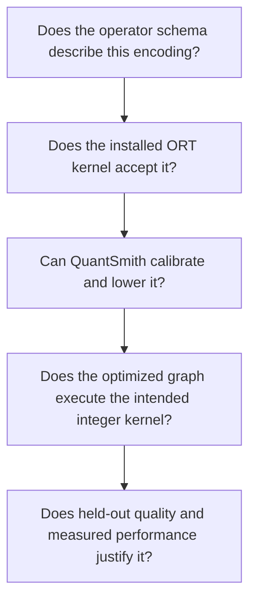

# Verified ORT integer operator capabilities

Created: 2026-10-17. Probe runtime: ONNX Runtime 1.30.0,
`CPUExecutionProvider`. These observations describe specific tested contracts;
they are not universal restrictions on quantization or all ORT operators.

## Separate the four questions

Q/DQ accepting an axis does not establish integer fusion support. Conversely, a
QuantSmith exclusion does not establish that ORT cannot execute the operator.

## Direct executable probes

`tests/backends/onnx/test_integer_capabilities.py` builds direct integer operators,
uses opset 17 and one CPU thread, and disables graph optimization. Thus successful
execution cannot be explained by a floating operator replacing a Q/DQ pattern.
The positive probes compare integer output codes with explicit reference
arithmetic, including rounding and saturation. All probes use UINT8 activation
inputs/outputs, INT8 weights and scalar zero points of zero.

| Operator and shapes | Activation scale | Weight scale | Output scale | Observed result |
| --- | --- | --- | --- | --- |
| QLinearConv, X `[1,3,1,2]`, W `[4,3,1,1]` | Scalar | Scalar | Scalar | Executes; exact reference codes |
| QLinearConv, same | Scalar | `[4]`, output channel | Scalar | Executes; exact reference codes |
| QLinearMatMul, A `[2,3]`, B `[3,4]` | Scalar | Scalar | Scalar | Executes; exact reference codes |
| QLinearMatMul, same | Scalar | `[4]`, output column | Scalar | Executes; exact reference codes |
| Both, same shapes | Multi-element `[3]` | `[4]` | Scalar | ORT rejects activation scale |
| Both, same shapes | Scalar | `[4]` | Multi-element `[4]` | ORT rejects output scale |
| Both positive variants | Scalar | Scalar or `[4]` | Scalar | Also execute when W is a runtime integer input |

There are eight positive cases (two operators × two weight granularities ×
constant/runtime weights) and four negative scale cases. Runtime integer weights
are already quantized values supplied to the kernel; these probes do not
implement dynamic FP32-weight quantization or dynamic activation calibration.
They establish no latency advantage for runtime weights and test no other shapes,
scale layouts, dtypes or execution providers.

## QuantSmith's narrower deployment contract

The table below describes static quantization. The separate
[dynamic W8A8 path](../src/quantsmith/algorithms/dynamic/README.md) supports
rank-two constant-weight MatMul projections with runtime activation quantization,
FP32 outputs, and no calibration samples. Runtime-weight attention products
remain outside both paths. Dynamic execution is source-audited on ORT CPU;
optimized ARM kernels can differ numerically from the serialized ONNX reference.

| Area | Current implementation | Evidence or restriction |
| --- | --- | --- |
| Conv input/output | Per-tensor INT8 or UINT8 activation encoding | Static planner and output lowering; tested signedness combinations |
| Conv weights | Symmetric per-output-channel encoding | Static planner; direct probes above use UINT8 activations |
| MatMul weights | Rank-two constant, per output column | `integer_execution/support.py`; direct ORT probes show constness is our restriction |
| Gemm | Rank-two constant weights, all transpose combinations; alpha=beta=1 | Operator fixture tests and integer audit require QGemm |
| Bias | Constant output-channel vector for Conv/Gemm; INT32 accumulator grid | Lowering checks shape, scale representability and INT32 bounds |
| Signedness | Signed activation requires signed weight | QuantSmith verified CPU contract; unsigned activation may use signed or unsigned symmetric weight encodings |
| Residual Add | Asymmetric UINT8 scalar input/output encodings | Boundary tests and compiled QLinearAdd audit |
| Remaining smoothing Div | Eligible positive scaling lowered through ORT QLinearMul | Dedicated code-boundary tests, clipping and integer-scaling probes |
| Dynamic attention products | Remain FP32 | No dynamic-operand calibration/lowering support in the static algorithm |
| Grouped Conv | Can be statically quantized; excluded from smoothing | Smoothing currently assumes a direct input-channel/weight-axis correspondence |
| Function-output calibration | Eligible private Conv→Relu/Clip only | Deliberate scope; broader archived changes regressed task accuracy |
| Reconstruction | Separate weight-code optimization; no static integer audit claim | Output-selected static smoothing explicitly rejected at that entry point |

Static planner and eligibility source:
`src/quantsmith/algorithms/static/__init__.py`,
`src/quantsmith/backends/onnx/integer_execution/support.py` and
`src/quantsmith/backends/onnx/integer_execution/lowering.py`.
The optimized deployment audit records source node, executed operator, domain,
provider and installed ORT version. It does not equate integer coverage with
speedup. See [integer execution](integer-execution.md) for the measured examples.

## Primary contracts and unresolved scope

The [QLinearConv schema](https://onnx.ai/onnx/operators/onnx__QLinearConv.html)
requires scalar activation input/output scales and permits per-output-channel
weight scales. The
[ORT CPU QLinearMatMul implementation](https://github.com/microsoft/onnxruntime/blob/main/onnxruntime/core/providers/cpu/quantization/quantize_linear_matmul.cc)
checks scalar/one-element activation scales separately from supported weight scale
shapes. The linked source is a moving upstream reference; installed 1.30.0 behavior
is established by the executable probes, not an assumption that upstream main
matches the wheel.

The matrix is incomplete by design: it does not establish per-token scales,
blocked/groupwise activation formats, MatMulIntegerToFloat scale layouts,
nonzero per-channel weight zero points, arbitrary batched matrix layouts or
additional fused activation functions. Each expansion needs its own minimal
numerical probe, quantizer representation, lowering and compiled execution audit.
A successful kernel probe alone does not justify a production default.

## Integrated float-output MatMul path

`FloatMatMulOutputs()` now exposes an explicitly planned MatMulIntegerToFloat
path: UINT8 per-tensor activations, rank-two constant symmetric INT8 weights with
per-output-column scales, and FP32 output without output requantization. Vector,
matrix and batched activation shapes, nonzero activation zero points, shared/public
outputs and floating bias placement have numerical tests. Source-provenance audits
require this exact integer kernel. Reconstruction explicitly rejects the policy.
Other MatMulIntegerToFloat layouts and signedness remain unverified; the direct
QLinearConv/QLinearMatMul probe table above is unchanged. See
[the integrated contract](float-matmul-outputs.md).
