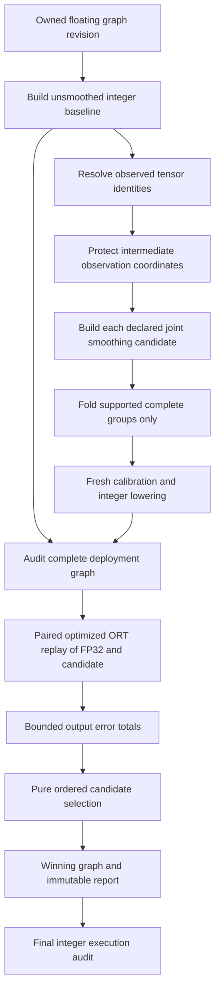

# Select smoothing from executed quantized outputs

Created: 2026-10-17. Status: implemented and evaluated on
`refactor/declarative-pipeline`; experimental, with defaults unchanged.
Author: Vadym Stupakov <vadim.stupakov@gmail.com>.
Authoritative source: `docs/output-based-smoothing.md` in this repository.

## Objective and background

Choose between declared smoothing graphs using the output error of their actual
lowered quantization. Channel histogram MSE evaluates separate hypothetical UINT8
grids; deployment combines per-tensor activation encoding, per-output-channel
weight encoding, bias quantization and output requantization. These are different
objectives. Better histogram error has already produced mixed held-out results in
[the channel histogram study](channel-histograms.md).

The first implementation selects a complete graph. It does not optimize individual
groups independently, learn a quantizer, search arbitrary graph rewrites or use
latency as its selection objective. All new behavior is opt-in; existing recipes
and boundary defaults remain unchanged.

## Numerical objective

For all declared observed tensors and streamed batches, accumulate the sum of
squared FP32/quantized differences and divide by their total element count. For
example, squared error 12 across 1,000 logits yields MSE 0.012; a candidate with
sum 9 yields 0.009 and wins. Equal errors retain declaration order. The built-in
configuration always declares no smoothing first.

This is element-weighted MSE: larger tensors and larger numerical magnitudes can
dominate. It is not an equal-layer, normalized, Hessian-weighted or task-loss
objective. The score guarantees only the minimum measured MSE among the declared
successful candidates, on the supplied replay. It does not guarantee held-out
accuracy, lower latency or reduced runtime memory.

## Architecture and interfaces



`optimization/smoothing` is a runtime-independent numerical core. It defines
`CandidateScore`, `SelectionReport`, `ModelOutputs`, `ContractionOutputs`,
`ObservedTensors` and pure selection functions. Records validate finite nonnegative
scores and unambiguous identities. No runtime registry or dictionary-based control
configuration is introduced.

`SelectSmoothingStage` is the ORT shell: a typed `FloatGraph -> QuantizedGraph`
step. Each `SmoothingCandidate` binds an identity to an injected
`Step[FloatGraph, QuantizedGraph]`. Existing `Pipeline` composition is sufficient;
no additional backend or evaluator abstraction is needed.

```python
from quantsmith import Quantizer
from quantsmith.config import (
    FollowCalibration,
    JointSmoothQuantConfig,
    OutputSelectedSmoothingConfig,
    PercentileConfig,
    QuantizationConfig,
)

config = QuantizationConfig(
    calibration=PercentileConfig(percentile=99.99),
    boundary_calibration=FollowCalibration(),
    smoothing=OutputSelectedSmoothingConfig(
        candidates=(
            JointSmoothQuantConfig(alpha=0.25),
            JointSmoothQuantConfig(alpha=0.5),
            JointSmoothQuantConfig(alpha=0.75),
        ),
    ),
)
quantizer = Quantizer.from_config(config)
```

Use `quantizer.quantize(model_proto).calibrate(iterable)` as before. The returned
`QuantizationResult.selection` is a `SelectionReport` when selection ran, otherwise
an `Absent` value with a reason. The report stores every candidate's MSE, maximum
absolute error, batch count, integer-node count and folded source-node identities,
alongside the selected identity and observed tensor names. It is JSON serializable.
Named `baseline` / `joint-N` identities are report data, not dispatch keys.
The report does not embed full candidate pipeline specifications; retain the
original typed configuration alongside it for reproducibility.

The built-in baseline and joint candidates both apply exact quantizer reuse so
this graph optimization does not confound the smoothing comparison. Joint
candidates use fold-only complete-group smoothing. Every transformed revision
receives fresh static calibration. Candidate construction or execution failures
stop with their existing `Err`; they are never silently dropped from selection.
Custom candidate steps remain responsible for honoring their declared semantics.

## Comparable observations and fusion

Default `ModelOutputs()` observes all public FP32 outputs. Their semantics already
constrain the folding implementation, so they stay in a common coordinate system.

With `ObservedTensors(names=(...))`, or `ContractionOutputs()` for all
baseline-quantized Conv/MatMul/Gemm outputs, the shell temporarily exposes these
names as graph outputs while constructing smoothing candidates. Existing public-
output folding guards then prevent rescaling those observed values. The added
outputs are removed before deployment audit and scoring; the deployed public
interface is unchanged. When extra observations are introduced, the baseline is
rebuilt with the same exposed cuts: public-output status can also affect
activation-function-aware calibration. Otherwise baseline and candidates could
silently use different calibration eligibility. This adds a baseline calibration
pass for intermediate observations; default model-output scoring needs no rebuild.

This protection matters: folding `a / s` into a producer changes the representation
of its output `a` even when downstream multiplication preserves the final function.
Comparing this transformed intermediate directly to the original is invalid.
Intermediate observations therefore constrain candidate folding and can change
which candidate graphs are available. They are explicit graph cuts, not free
observability.

Scoring uses `ORT_ENABLE_ALL` on the FP32 reference and each quantized candidate.
The complete uninstrumented candidate is audited before replay. Exposing internal
tensors for diagnostic replay can inhibit ORT fusions, so internal scores describe
that instrumented execution and are not proof of identical production rounding or
latency. Default public-output scoring avoids adding intermediate graph cuts.
Latency is measured separately on the deployed model, without these diagnostic
outputs. See [operator capability evidence](ort-capabilities.md).

## Resources and failure contracts

Each candidate starts from an owned copy of the same input revision. The shell
retains the incumbent graph, current candidate and scalar score records, not a
dataset or a bank of activations. It releases losing candidates; retained graph
copies and ORT sessions still consume model-size memory, and this is not a hard
total-process memory cap. Histogram collection retains its explicit independent
budget. Candidate count multiplies calibration, compilation and replay work.

Each reference/candidate pair receives the same current sample. Separate passes
and candidates rely on the existing deterministic `Samples` contract. The selector
does not fingerprint all input bytes or detect in-range nondeterministic replay.
The same replay calibrates and selects; an independent held-out set is required to
assess task quality. Unknown/non-FP32 observations and empty sources fail explicitly.

Output-selected smoothing is rejected by the reconstruction API. That API changes
weight codes and does not currently audit integer execution; applying a static
candidate objective there would misrepresent the deployed computation. A separate
reconstruction-aware objective remains future work.

## Alternatives and remaining decisions

- Independent histogram MSE is cheaper but misses combined deployed rounding.
- A global alpha sweep is supported by declared candidates; no optimizer dependency
  is needed for a small finite set. Optuna can later construct typed candidates.
- Per-group coordinate descent needs comparable local outputs and rules for
  interacting groups; it is not implemented by this whole-graph selector.
- Layer normalization of loss, task-aware objectives, separate selection replay,
  and explicit latency/ROM/RAM constraints require independent designs/evidence.
- Lower reconstruction error is not a release gate. Review the full held-out
  comparison before changing defaults.

## Verification

`just check` passes all 841 tests, Ruff checks/formatting and strict Pyrefly.
Coverage includes six Conv/MatMul/Gemm layout fixtures, shared affine producers,
nonlinear/public barriers, intermediate-coordinate protection, equal
activation-function calibration eligibility, exact independent ORT score replay,
empty data, invalid observations, propagated candidate failures, and real exported
CNN/Stackformers graphs. Reconstruction explicitly rejects this static objective.

## Experiment

The study compares the unsmoothed baseline and joint extrema smoothing with
alpha 0.5, separately for static MinMax and Percentile 99.99. Boundary calibration
stays at legacy MinMax throughout this experiment to isolate the objective change.
Both candidates use exact quantizer reuse. It also remeasures saved FP32 and
accepted MinMax/Percentile controls.

Raw candidates, reports, selected graphs, hashes, optimized graphs and ORT JSON
traces are retained under ignored `work_dir/artifacts/output_selection/`.

### Study setup

The same saved checkpoints and splits as the previous studies are used: three
pretrained torchvision CNNs on 128 Imagenette training calibration images and 256
validation images (seed 42), plus two small trained Stackformers checkpoints
(two layers, dimension 64, four heads, sequence length 32, 600 training steps).
Transformers use 64 calibration contexts and 128 held-out contexts (4,096 targets).
These are small experimental text models, not pretrained production LLMs.

Timing uses the same saved batch-one input per model, ORT 1.30.0 CPU, one thread,
all graph optimizations, 50 warmups, 300 image / 1,000 token timed runs, and a
separate 100-call profiling session. ROM is serialized ONNX size. RAM is runtime
process cumulative peak RSS including startup and initialization; calibration
workspace and steady-state tensor memory are not isolated by this measurement.
Timing inputs are fixed; task metrics use the held-out samples above.

### Calibration decisions and held-out outcomes

`joint-0` is joint extrema smoothing with alpha 0.5. Both candidates use exact
activation-quantizer reuse. Every selected graph is byte-identical to the saved
winning candidate. All ten selection reports and execution audits are retained.
The table compares each winner with its corresponding unsmoothed candidate.

| Model | Static method | Selected | Baseline calibration MSE | Joint calibration MSE | Baseline top-1 % | Selected top-1 % | Baseline PPL | Selected PPL |
| --- | --- | --- | ---: | ---: | ---: | ---: | ---: | ---: |
| transformer | minmax | baseline | 0.00729326 | 0.00763094 | 40.94 | 40.94 | 7.9762 | 7.9762 |
| transformer | percentile | baseline | 0.00631045 | 0.00648131 | 40.60 | 40.60 | 7.9658 | 7.9658 |
| windowed_transformer | minmax | joint-0 | 0.00731336 | 0.00723832 | 41.02 | 40.77 | 7.9579 | 7.9406 |
| windowed_transformer | percentile | baseline | 0.00608434 | 0.00632768 | 41.02 | 41.02 | 7.9478 | 7.9478 |
| resnet18 | minmax | joint-0 | 0.09655312 | 0.07963303 | 66.41 | 66.80 | — | — |
| resnet18 | percentile | joint-0 | 0.05373746 | 0.04906849 | 67.19 | 66.80 | — | — |
| mobilenet_v2 | minmax | joint-0 | 0.06798162 | 0.06770213 | 58.59 | 58.20 | — | — |
| mobilenet_v2 | percentile | joint-0 | 0.03881320 | 0.03810367 | 63.67 | 63.28 | — | — |
| efficientnet_b0 | minmax | joint-0 | 1.26743774 | 1.24484098 | 28.52 | 26.17 | — | — |
| efficientnet_b0 | percentile | baseline | 0.34218831 | 0.34494691 | 64.84 | 64.84 | — | — |

### Complete model × variant measurements

`baseline_*` is unsmoothed with exact quantizer reuse. `joint_*` is the smoothing
candidate. `selected_*` is the exported winner, timed independently even when its
bytes equal a candidate. `int8_*` are the saved accepted controls. Distinct timings
for identical graphs illustrate run variation; they are not optimizer gains.
The initial sweep and raw traces are retained in full; clean forward/reverse
repetitions below provide additional timing observations.

| Model | Variant | Initial median ms | ROM KiB | Process peak RSS MiB | Top-1 % | PPL |
| --- | --- | ---: | ---: | ---: | ---: | ---: |
| transformer | onnx_fp32 | 0.0865 | 527.4 | 73.8 | 41.06 | 7.9636 |
| transformer | int8_minmax | 0.0954 | 345.5 | 74.0 | 40.94 | 7.9762 |
| transformer | int8_percentile | 0.0959 | 345.5 | 73.9 | 40.60 | 7.9658 |
| transformer | baseline_minmax | 0.0935 | 344.4 | 74.0 | 40.94 | 7.9762 |
| transformer | joint_minmax | 0.0937 | 343.3 | 74.0 | 40.94 | 7.9739 |
| transformer | selected_minmax | 0.0933 | 344.4 | 74.0 | 40.94 | 7.9762 |
| transformer | baseline_percentile | 0.0935 | 344.4 | 74.0 | 40.60 | 7.9658 |
| transformer | joint_percentile | 0.0932 | 343.3 | 74.0 | 40.72 | 7.9698 |
| transformer | selected_percentile | 0.0940 | 344.4 | 74.0 | 40.60 | 7.9658 |
| windowed_transformer | onnx_fp32 | 0.0837 | 532.7 | 73.7 | 40.92 | 7.9329 |
| windowed_transformer | int8_minmax | 0.0941 | 350.7 | 74.0 | 41.02 | 7.9579 |
| windowed_transformer | int8_percentile | 0.0941 | 350.7 | 74.1 | 41.02 | 7.9478 |
| windowed_transformer | baseline_minmax | 0.0910 | 349.6 | 74.0 | 41.02 | 7.9579 |
| windowed_transformer | joint_minmax | 0.0914 | 348.5 | 74.2 | 40.77 | 7.9406 |
| windowed_transformer | selected_minmax | 0.0925 | 348.5 | 74.2 | 40.77 | 7.9406 |
| windowed_transformer | baseline_percentile | 0.0915 | 349.6 | 74.1 | 41.02 | 7.9478 |
| windowed_transformer | joint_percentile | 0.0929 | 348.5 | 74.1 | 40.80 | 7.9400 |
| windowed_transformer | selected_percentile | 0.0930 | 349.6 | 73.9 | 41.02 | 7.9478 |
| resnet18 | onnx_fp32 | 4.4001 | 45733.3 | 213.0 | 66.02 | — |
| resnet18 | int8_minmax | 9.5268 | 11629.8 | 123.3 | 66.41 | — |
| resnet18 | int8_percentile | 9.5189 | 11629.8 | 123.1 | 67.19 | — |
| resnet18 | baseline_minmax | 9.0605 | 11628.5 | 119.9 | 66.41 | — |
| resnet18 | joint_minmax | 9.0582 | 11629.1 | 120.2 | 66.80 | — |
| resnet18 | selected_minmax | 9.0709 | 11629.1 | 120.0 | 66.80 | — |
| resnet18 | baseline_percentile | 9.4771 | 11629.3 | 123.3 | 67.19 | — |
| resnet18 | joint_percentile | 9.5192 | 11629.9 | 123.1 | 66.80 | — |
| resnet18 | selected_percentile | 9.5462 | 11629.9 | 123.2 | 66.80 | — |
| mobilenet_v2 | onnx_fp32 | 4.3972 | 13882.5 | 116.4 | 64.06 | — |
| mobilenet_v2 | int8_minmax | 4.1844 | 4031.6 | 107.9 | 58.59 | — |
| mobilenet_v2 | int8_percentile | 3.8103 | 4031.6 | 108.0 | 63.67 | — |
| mobilenet_v2 | baseline_minmax | 3.7509 | 4030.0 | 107.5 | 58.59 | — |
| mobilenet_v2 | joint_minmax | 3.7623 | 4030.6 | 107.8 | 58.20 | — |
| mobilenet_v2 | selected_minmax | 3.7817 | 4030.6 | 107.6 | 58.20 | — |
| mobilenet_v2 | baseline_percentile | 3.8148 | 4031.6 | 108.0 | 63.67 | — |
| mobilenet_v2 | joint_percentile | 3.8123 | 4032.2 | 107.9 | 63.28 | — |
| mobilenet_v2 | selected_percentile | 3.8047 | 4032.2 | 107.9 | 63.28 | — |
| efficientnet_b0 | onnx_fp32 | 11.7187 | 21214.9 | 142.0 | 75.00 | — |
| efficientnet_b0 | int8_minmax | 8.4940 | 6384.0 | 133.8 | 28.52 | — |
| efficientnet_b0 | int8_percentile | 8.6285 | 6384.0 | 133.0 | 64.84 | — |
| efficientnet_b0 | baseline_minmax | 8.5120 | 6382.6 | 132.7 | 28.52 | — |
| efficientnet_b0 | joint_minmax | 8.5129 | 6383.2 | 133.7 | 26.17 | — |
| efficientnet_b0 | selected_minmax | 8.5510 | 6383.2 | 133.3 | 26.17 | — |
| efficientnet_b0 | baseline_percentile | 8.5746 | 6384.0 | 133.3 | 64.84 | — |
| efficientnet_b0 | joint_percentile | 8.5690 | 6384.6 | 133.1 | 63.28 | — |
| efficientnet_b0 | selected_percentile | 8.5436 | 6384.0 | 132.6 | 64.84 | — |

### Repeated timing

After construction, held-out evaluation and code verification finish, fresh
ORT-only workers execute serially in forward then reverse order. These are
repetitions, not confidence intervals. Only distinct candidate graphs and FP32
are remeasured; selected graphs are identical to a candidate and add no new graph.

| Model | Variant | Repeat 1 ms | Repeat 2 ms |
| --- | --- | ---: | ---: |
| transformer | onnx_fp32 | 0.0816 | 0.0783 |
| transformer | baseline_minmax | 0.0925 | 0.0923 |
| transformer | joint_minmax | 0.0922 | 0.0921 |
| transformer | baseline_percentile | 0.0917 | 0.0943 |
| transformer | joint_percentile | 0.0914 | 0.0924 |
| windowed_transformer | onnx_fp32 | 0.0839 | 0.0755 |
| windowed_transformer | baseline_minmax | 0.0934 | 0.0928 |
| windowed_transformer | joint_minmax | 0.0941 | 0.0949 |
| windowed_transformer | baseline_percentile | 0.0935 | 0.0912 |
| windowed_transformer | joint_percentile | 0.0949 | 0.0910 |
| resnet18 | onnx_fp32 | 4.6565 | 4.7844 |
| resnet18 | baseline_minmax | 9.5638 | 9.6260 |
| resnet18 | joint_minmax | 9.6334 | 9.6416 |
| resnet18 | baseline_percentile | 9.7672 | 10.1453 |
| resnet18 | joint_percentile | 9.7447 | 10.5035 |
| mobilenet_v2 | onnx_fp32 | 4.4654 | 4.8044 |
| mobilenet_v2 | baseline_minmax | 3.7496 | 4.0243 |
| mobilenet_v2 | joint_minmax | 3.7584 | 4.4265 |
| mobilenet_v2 | baseline_percentile | 3.8150 | 4.2146 |
| mobilenet_v2 | joint_percentile | 3.9358 | 4.0675 |
| efficientnet_b0 | onnx_fp32 | 11.6621 | 12.0725 |
| efficientnet_b0 | baseline_minmax | 8.7296 | 9.0120 |
| efficientnet_b0 | joint_minmax | 8.5639 | 8.8781 |
| efficientnet_b0 | baseline_percentile | 8.9682 | 8.8726 |
| efficientnet_b0 | joint_percentile | 8.8401 | 8.8956 |

## Interpretation and adoption decision

- The objective is now the executed quantized model's output error, rather than an
  independent channel-grid proxy. It chooses the lower measured calibration MSE
  in all ten comparisons and selects the baseline in four.
- This is **not sufficient to select task-safe smoothing**. Of the six decisions
  selecting joint smoothing, held-out top-1 improves once and decreases five
  times. ResNet18 MinMax improves 66.41% → 66.80%, while its Percentile variant
  drops 67.19% → 66.80%. MobileNetV2 drops 58.59% → 58.20% for MinMax and
  63.67% → 63.28% for Percentile. EfficientNetB0 MinMax drops 28.52% → 26.17%.
- Windowed-transformer MinMax illustrates conflicting task metrics: top-1 drops
  41.02% → 40.77%, while perplexity improves 7.9579 → 7.9406. Its Percentile
  variant and both global-transformer methods select the unsmoothed baseline.
- EfficientNetB0 Percentile selects baseline and avoids the joint candidate's
  64.84% → 63.28% top-1 regression. Its poor MinMax accuracy remains unresolved.
- Integer node counts stay equal within each model's candidate comparison:
  15 for each transformer, 29 for ResNet18, 63 for MobileNetV2 and 91 for
  EfficientNetB0. Counts include integer residual Add and Gemm where applicable.
  They establish coverage, not task quality or speed.
- The selector itself adds calibration/compilation work, not inference nodes.
  Runtime executes one chosen existing graph. It has no independent inference
  speedup, and no latency improvement is guaranteed by its MSE objective.

**Keep this mode experimental and opt-in. Do not promote it into accepted example
recipes or defaults from these results.** A task-aware objective or explicit
independent validation decision is needed before adopting a selected candidate.
There is no new universal task/latency threshold or automatic release gate.

Raw evidence: `work_dir/artifacts/output_selection/{model}/selection_*.json`,
`selection_*.execution.json`, saved baseline/joint/selected ONNX files,
`fingerprints.json`, `cases.json`, `scores.json`, profiling reports, optimized ONNX
files and raw `ort_*.json` traces. Final runtime measurements are separate from
selection replay. Candidate-selection graph copies and calibration process peak were not
measured as steady-state inference RAM.
