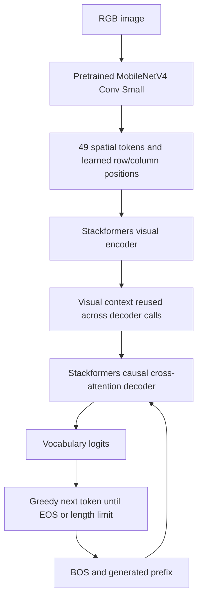

# MobileNetV4 + Stackformers image captioning

Train an image-to-description model, export its image encoder and caption decoder,
and compare FP32 against five whole-model W8A8 policies, two encoder-only policies,
and two CNN-only policies with an unchanged FP32 decoder. All attention and Transformer
layers come from Stackformers. Training uses PyTorch AdamW.



Run from the repository root. uv installs the pinned example dependencies; the
entry point downloads pretrained weights, fetches only caption members of the COCO
annotation ZIP with range requests, indexes annotations in SQLite, and caches only
the configured images. Images and metadata live under `work_dir/`.

```sh
uv run --locked --group examples -m examples.mobile_captioning.main
```

The defaults are an explicit **smoke experiment**: 512 training images, 300 updates,
16 calibration images, and 32 evaluation images. They exercise the complete path;
they do not establish useful captioning quality or a production accuracy tradeoff.
Default model: 224×224 input, 256 hidden dimensions, four heads, two encoder layers,
four decoder layers, SwiGLU multiplier 3, and a 32-token decoder buffer. Only the CNN
starts pretrained; it is frozen by default. The vocabulary contains at most 8,192
training-only word types, including four special tokens.

Train separately, then rerun benchmarks without retraining:

```sh
uv run --locked --group examples -m examples.mobile_captioning.main --command train
uv run --locked --group examples -m examples.mobile_captioning.main --command benchmark
```

`train` starts fresh. `run` trains when no completed checkpoint exists and otherwise
loads it. Model weights use the standard Torch state dictionary; `checkpoint.json`
binds the model geometry, vocabulary, and training controls. Optimizer state is not
persisted. To start an independent experiment, select a different `--output`.

Model settings are typed JSON, for example:

```sh
uv run --locked --group examples -m examples.mobile_captioning.main \
  --output work_dir/artifacts/caption_short \
  --model '{"image_size":224,"dim":256,"heads":4,"encoder_layers":2,"decoder_layers":4,"max_tokens":16}'
```

Choose larger training, calibration, and validation budgets explicitly for a quality
study. `--evaluation-images 5000` admits the full COCO 2017 validation split. Data
loading keeps one minibatch and a bounded download window; the upstream caption
scorers retain only the explicitly bounded evaluation corpus, capped at 5,000 images.
`--quiet` suppresses progress and `--json-output` prints the report JSON.

Each run retains:

- `weights.pt`, `checkpoint.json`, and `vocabulary.sqlite3`;
- `fp32/{encoder,decoder}.onnx` and each candidate's graphs, plans, policies, and
  integer execution audit;
- `captions.jsonl` with every admitted evaluation caption and its references;
- two fresh-process timing reports per variant in forward/reverse order;
- raw encoder/decoder ORT JSON traces and optimized graphs, collected separately
  after latency and RSS measurement;
- `summary.md` with the complete table and `report.json` with environment versions,
  checkpoint and annotation hashes, caption metrics,
  encoder/decoder latency, EOS-dependent generation, fixed-step generation, ROM,
  and process RSS high-water marks.

Calibration uses separate COCO training images whose IDs are divisible by 20;
training excludes them. Evaluation uses `val2017`. Decoder calibration replays
several teacher-forced prefix lengths with each candidate encoder's actual context.
Generated-prefix calibration is an open improvement.

The decoder currently recomputes the whole padded buffer and the cross-attention
context projections on every step. Stackformers 4.6 exposes no incremental KV-cache
interface. Reports include equal-step generation so different EOS decisions cannot
masquerade as kernel speedups. Preprocessing, downloads, session startup, and task
scoring are excluded from warmed timing; process RSS includes initialization and
allocator behavior. CIDEr and BLEU-4 use the COCO Python scorers with the declared
lowercase regex tokenizer, **not official PTB tokenization or leaderboard scores**.

See [architecture and restrictions](../../docs/mobile-captioning.md) and the
adjacent [experiment log](DEVLOG.md).
