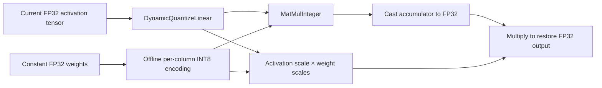

# Dynamic W8A8

Dynamic quantization measures the current activation tensor during inference.
Projection weights are quantized once, offline. This lets an autoregressive model
adapt its activation grid between prefill and successive decode calls without a
representative calibration dataset.

For example, an activation interval `[0, 2.55]` gives a UINT8 step of `0.01`.
If a later call spans `[0, 25.5]`, its step becomes `0.1`; values do not clip at the
previous call's maximum. A weight column whose largest absolute value is `1.27`
uses a symmetric INT8 step of `0.01`. The integer dot product is restored to FP32
with the product of the activation and weight steps. Each output column can have
its own weight step; outputs have no additional quantization grid.



## Use

```python
from quantsmith import Quantizer
from quantsmith.config import DynamicQuantizationConfig

outcome = Quantizer.from_config(DynamicQuantizationConfig()).quantize(model).execute()
```

Handle `Ok(result)` and `Err(error)` explicitly. `result.plans` contains
`DynamicQuantizeMatMul` operations with owned weight encodings; no activation
scale is invented during planning. `result.execution` verifies source-matched
integer CPU kernels and records excluded nodes with reasons. A graph with no
eligible projections returns an empty integer-node report, not an integer claim.

For custom selection, compose
`Pipeline(DynamicQuantizationStage(rules)).then(VerifyStage())`, importing the
stages from `quantsmith.backends.onnx.dynamic` and
`quantsmith.backends.onnx.stages`. The rules contain `DynamicW8A8()`, `Exclude`,
or an `Algorithm` plugin with no calibration needs and only dynamic MatMul
operations. Expected plugin failures propagate as `Err`; unexpected exceptions
remain exceptions.
The pure algorithm requests `Needs()` and ignores activation statistics. The
dynamic stage never reads the sample source, including one supplied to
`.calibrate(...)` for compatibility with the existing facade.

## Scope and limitations

- Supports standard FP32 `MatMul` with rank-two constant weights, including
  vector, matrix, and batched activations. Uses symmetric per-output-column INT8
  weights and per-tensor asymmetric UINT8 activations in the serialized graph.
- Preserves symbolic sequence/batch dimensions and graph input/output names.
  Existing floating KV-cache inputs/outputs remain floating; this does not add
  caching to a model or quantize the cache.
- Runtime-weight attention products (QKᵀ/AV), Gemm, Conv, and custom/fused
  attention operators are excluded. Export projections as standard MatMul nodes.
- Flat graphs only: existing admission rejects control-flow subgraphs and
  overridable initializers. Selected weights must be finite and nonempty.
- Fold smoothing scales before this stage. Dynamic configuration itself needs
  no smoothing or calibration; custom pipelines can precede it with fold-only
  transformations that do require calibration samples.
- Serializes standard ONNX operators. The deployment audit targets ORT's
  `CPUExecutionProvider`; support on another provider is not established here.
- ORT may fuse to `com.microsoft::DynamicQuantizeMatMul` or retain an explicit
  quantizer feeding an integer kernel. Optimized kernels can choose different
  activation quantization arithmetic: ORT 1.30's ARM KleidiAI path can differ
  numerically from the unfused per-tensor reference. Test the actual deployment
  runtime and optimization settings rather than assuming bitwise agreement.
- Runtime range collection costs time; integer execution alone does not prove a
  latency improvement. Evaluate held-out quality and both prefill/decode latency.

Dynamic W8A8 means activation ranges are determined from the current inference
input while the projection's weight encoding stays fixed.

## Primary references

- [ONNX DynamicQuantizeLinear](https://onnx.ai/onnx/operators/onnx__DynamicQuantizeLinear.html)
- [ONNX MatMulInteger](https://onnx.ai/onnx/operators/onnx__MatMulInteger.html)
- [ORT 1.30 dynamic MatMul CPU implementation](https://github.com/microsoft/onnxruntime/blob/v1.30.0/onnxruntime/contrib_ops/cpu/quantization/dynamic_quantize_matmul.cc)
