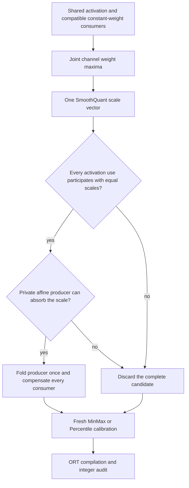

# Joint SmoothQuant

Choose one channel scale for projections that read the same activation. This lets
an affine producer absorb that scale once while all participating consumers
compensate through their weights.

For example, activation magnitudes `[4, 9]` feed two matrices with input-channel
magnitudes `[1, 4]` and `[4, 1]`. Independent SmoothQuant at `alpha=0.5` chooses
`[2, 1.5]` and `[1, 3]`. A shared producer cannot absorb two different vectors.
Taking the maximum weight magnitude over siblings gives `[4, 4]`, and both
projections use `[1, 1.5]`. Divide the producer's output-channel weights and bias
by that vector; multiply both consumers' input-channel weights by it. The float
computation remains equivalent within FP32 rounding.



For channel `j`, `w[j]` is the maximum absolute weight across compatible siblings'
contraction channels. The scale is `a[j]^alpha / w[j]^(1-alpha)`, with identity
scaling when either magnitude is zero. The scale balances the common activation
against the strongest weight channel in the group.

```python
from quantsmith import Quantizer
from quantsmith.config import JointSmoothQuantConfig, QuantizationConfig

config = QuantizationConfig(smoothing=JointSmoothQuantConfig(alpha=0.5))
outcome = Quantizer.from_config(config).quantize(model_proto).calibrate(dataset)
```

`JointSmoothQuant` implements the existing pure `Algorithm` protocol. It emits
one `RescaleInput` for the selected consumer; siblings independently derive the
same vector from the immutable graph and channel statistics. No ONNX execution,
filesystem operation, activation cache, or runtime registry belongs to the
algorithm. Channel magnitudes are computed during planning, not inference.

The ORT `JointFoldOnly` policy groups these operations by activation identity,
requires identical scales and contraction axes, and owns a private candidate.
Only complete groups may change shared producers. Excluded or incompatible
consumers, public outputs, unsupported nonlinearities/broadcasts, or missing
constant affine parameters leave every consumer's original region intact.
Supported producer paths and positive Relu propagation match fold-only smoothing.
The config's smoothing selector skips dynamic attention and grouped Conv layouts;
its following static stage can still quantize supported constant-weight Conv.

The pure planner considers all compatible constant-weight siblings, including
siblings excluded by a caller's rules. Folding then refuses an incomplete group.
Different alphas or incompatible layouts can likewise prevent group folding.
There is no silent partial update, weight duplication, or fallback-method chain.

The final static stage recollects statistics after folding. Changed INT8 grids can
change task accuracy even though floating computation is preserved. A folded
operation is not evidence of faster execution. Shared smoothing also does not
by itself make ORT reuse separate QuantizeLinear nodes with identical grids.

## References and limits

This is a coordinated adaptation of the offline channel transformation in
[SmoothQuant, Xiao et al., ICML 2023](https://proceedings.mlr.press/v202/xiao23c.html).
The [authors' implementation](https://github.com/mit-han-lab/smoothquant) is the
primary implementation reference. This project does not claim a new published
algorithm or reproduce the paper's complete LLM execution stack.

Measured outcomes and restrictions are recorded in
[the experiment report](../../../../../docs/joint-smoothing.md). Existing accepted
recipes remain unchanged until task and latency observations justify adoption.

## Histogram-informed channel ranges

`JointSmoothQuant(channels=ChannelPercentile(percentile=99.9))` or
`JointSmoothQuant(channels=ChannelMSE(min_percentile=99.0, candidates=16))` requests
bounded per-channel histograms through the existing pure planning contract.
`ChannelExtrema()` preserves the earlier scale-selection behavior. Histogram-selected
ranges guide smoothing scales; they do not clip the floating graph or add runtime
activation operations. MSE is an eight-bit channel-grid proxy, not final network
loss. The following static stage recollects statistics on the folded revision.
See [the histogram design and experiment](../../../../../docs/channel-histograms.md).
