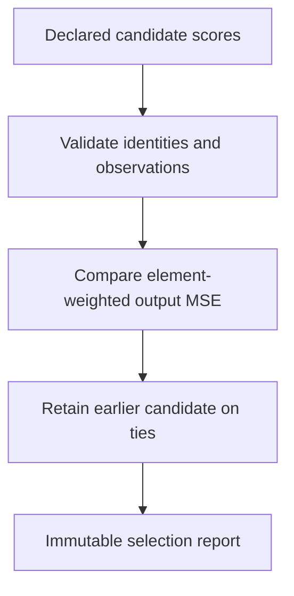

# Output-based smoothing selection

A channel histogram describes individual activations. The deployed integer
operator also rounds its weights, bias and output. Choose smoothing candidates by
comparing their executed outputs with FP32 instead of assuming a smaller channel
histogram error means a better layer or model.

For example, suppose no smoothing produces squared errors totaling 12 across
1,000 logits, while joint smoothing produces 9. Their MSEs are 0.012 and 0.009;
select joint smoothing. A tie retains the earlier declaration, with the unsmoothed
baseline first in the built-in configuration. This measures reconstruction error,
not classification accuracy or latency.

The core contains observation policies, validated immutable score/report records,
and pure `prefer` / `select` functions. It imports no graph format, runtime,
filesystem or dataset machinery. The ONNX shell builds candidates, collects fresh
calibration, audits integer execution, and streams paired output replay.

Selection is over complete graphs, not independent layers or coordinate descent.
Default observations are public model outputs. Explicit intermediate observations
must be protected from folding so their coordinates remain comparable. Large
observed tensors contribute more elements to MSE. Calibration-set improvement
does not establish held-out task improvement. Histogram policies remain optional
candidate inputs; this objective does not replace their statistics collector.

See [design, restrictions and evidence](../../../../docs/output-based-smoothing.md)
and the [original SmoothQuant paper](https://arxiv.org/abs/2211.10438) for the
activation/weight rescaling identity. Output-based candidate selection here is a
local implementation choice, not a claim to implement that paper's full recipe.
